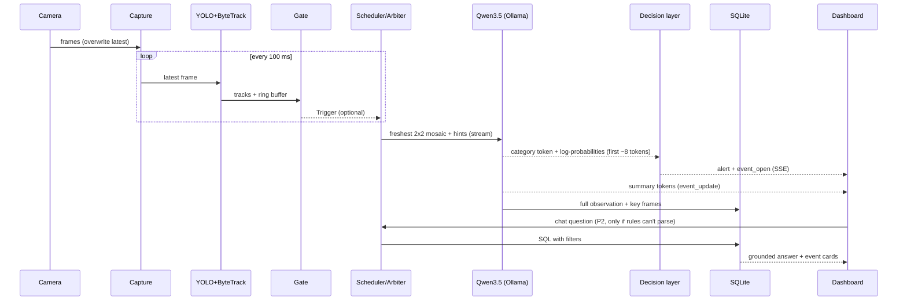

# SPEC.md: System Specification & Universal Contract

> **Version:** v1.25 (2026-10-17): Telegram alerts replace WhatsApp (D91: Meta banned the WhatsApp Business account): `app/telegram.py` replaces `app/whatsapp.py` (§11); `telegram: {enabled, severities, cooldown_s, snapshot}` replaces `whatsapp:` (§10); sent through Telegram's Bot API; opt-in, idle unless `TELEGRAM_BOT_TOKEN` and `TELEGRAM_CHAT_ID` are set in the environment; the same two messages as v1.24; never video; the alert path only queues them. v1.24 (2026-10-17): WhatsApp alerts (D90): `app/whatsapp.py` (§11); `whatsapp: {enabled, severities, cooldown_s}` (§10); sent through Meta's WhatsApp Cloud API; opt-in, idle unless `WHATSAPP_TOKEN`, `WHATSAPP_PHONE_ID` and `WHATSAPP_TO` are set in the environment; each critical or high alert goes out as a message (category, camera, severity, confidence, IST time, onset or trigger → alert, a suggested action, event id), followed with `snapshot` by the event's key frame captioned with the model's summary and top-3 reading; never video; the alert path only queues them. v1.23 (2026-10-17): ESP32 guard console (D89): `firmware/esp32/console` + `app/console.py` (§11); `console: {enabled, port}` (§10); metrics carry `console: {connected, port, timing, last}` (§9.1); a press of the board's button during an alarm acknowledges it like `POST /api/events/{id}/ack`. v1.22 (2026-10-16): calibration and the sample drop (D86): gate hints name the hypothesis and its look-alikes and leave the call to the frames (§6.6, §7.4); §6.1 wording for fighting, person_down, crowd_incident, property_damage and suspicious_activity; a baseline is skipped only if no person moved or changed shape since the camera's last call and not right after an incident reading that opened nothing; `vlm.baseline_skip.max_skip_s` 15 → 8, `vlm.empty_interval_s` 10 → 5 (§10); uploads take every common video container (FR-5); `chat.model`/`chat.base_url` honoured (§10). v1.21 (2026-10-16): dashboard slots (D82): Clips mode plays up to 3 clips side by side, one per column: `POST /api/clips/play {path, slot}` and `POST /api/cameras/upload?name=&slot=` replace only that slot's clip (no `slot` = the old one-at-a-time behaviour, slot 1); `POST /api/cameras {source, name, slot}` in Live mode replaces that slot's source (no slot = the first free column); `GET /api/cameras` rows carry `slot`; `slot` outside 1-3 → 400. v1.20 (2026-10-16): `gate.fight_speed` 0.6 → 0.5 (D80: the shove's peak at its onset was 0.55); the bench reports onset → alert in two groups, steady state (incident starts ≥ `mosaic_span_s` into the clip, the headline) and mid-start (starts earlier: also times the buffer filling), plus onset → gate per clip; shift-handover digest (FR-17, D81): `GET /api/digest?hours=&camera=`, the Ask tab's "Shift handover" button. v1.19 (2026-10-16): hint contract (D78): the user turn is labelled detector metadata (`vlm.user_turn()`), hint text carries no track ids and never the word gate, the system prompt forbids mentioning it in summaries (§5a step 6, §7.4); operator workflow (D79, FR-25 built): `POST /api/events/{id}/dismiss` drops the event from the open set and holds that camera + category for `events.dismiss_hold_s` (60 s); report tab (FR-20, first cut): `GET /api/report` (newest `bench.ab --dev` pass + live operator numbers), `GET /api/report/feedback.csv` (operator labels). v1.18 (2026-10-16): the window open threshold is 0.50 for the categories no gate can corroborate (`crowd_incident`, `property_damage`, `suspicious_activity`; `events.open_window_ungated`, D77); gated categories and `fire_smoke` keep 0.55. v1.17 (2026-10-16): chat v2 (D75): the model writes every answer that has events (conversational, every sentence cited, D57 check kept; templates are the fallback); the model reads the question (§5a.2 step 3, JSON schema with the §6.1 definitions, a `meaning` paraphrase first) when the rules find no filter, find nothing, or the session has earlier turns (follow-ups use the last 3 turns per `session_id`); the rules keep clock times, #ids and exact camera matches; `how` adds `read_by` (`rules`|`model`), `read_ms`, `note`; `chat.llm` switch (§10). v1.16 (2026-10-16): chat search (D74): both FTS5 tables use the Porter stemmer (`tokenize='porter unicode61'`: push = pushed = pushing), an older DB is migrated on open; filler words (someone, anyone, person, people, two…) are never required keywords; still every keyword must match (no any-word fallback, so a grounded "no match" stays). v1.15 (2026-10-16): P5 Round-1 hardening (D73): `vlm.duty_target` 0.60 → 0.55 (§10; idle 2-camera duty sat at the 0.60 target, D72); D71's `how` chat field signed off; a clip may carry an optional door zone so a real tailgating clip isn't vetoed (approved; built when a door clip exists). v1.14 (2026-10-16): Live-mode fix (D72): tiles load `GET /snapshot/{camera_id}` (the newest annotated JPEG) at ~10 fps, double-buffered, replacing the MJPEG `/stream` (Safari painted half-received frames grey); `fighting` gate: the pair's boxes within 2× height of each other (`fight_min_height_ratio` 0.5) and overlapping on some frame in the last `fight_contact_s` (0.5 s) instead of on the current one; at most one ① per camera in flight (a trigger refreshes a waiting ① or merges into a running one, never queues); a silenced wide track re-arms only once its box is clearly upright (< 0.8 × `down_ratio`). v1.13 (2026-10-16): chat v1 (D71): the `POST /api/chat` response adds `how` (`template`, or `model` with rows / sentences kept / dropped) and each returned event carries `camera_name`; filters add `subtypes` and `unknown_cameras`; the FTS5 tables are kept in sync by triggers; §5a.2 step 3 (model extraction) is not in v1. v1.12 (2026-10-16): demo modes Clips | Live (D70): nothing runs at boot; `POST /api/mode` (switching stops every source, history kept); Clips plays ONE playlist clip (`GET /api/clips`, `POST /api/clips/play`) or upload at a time, once; Live adds devices (`GET /api/devices`) and http/https/rtsp URLs (`POST /api/cameras`, R1 now); per-tile status `connecting`; thumbnails only for non-normal observations. v1.11 (2026-10-16): duty control (D66, D67): `vlm.duty_target` (0.60) — while GPU duty (60 s) is above it, baselines back off to one per camera per 15 s; ① calls are never throttled and run before any queued ③; a ① whose category matches an event already open on that camera stops at the category (no summary, the event just updates). v1.10 (2026-10-16): P2b diagnosis (D63, D64): `fighting` vetoed only when the detector saw nobody in the 4 s buffer; `vetoes` metric counts only vetoes with p ≥ 0.3; `fight_speed` 1.0 → 0.6 + fight-pair silence after a confident-normal verdict; an `ended` clip/upload counts as down for the close rule. v1.9 (2026-10-16): P3 dashboard API additions (D62): alert `t_stored` + `onset_to_alert_ms`, metrics per-camera `people`/`now` + `latency` block, `POST /api/ui/latency` (browser-measured store→card), upload as raw body with `?name=`. v1.8 (2026-10-16): category probabilities by a prefix-tree walk over the value tokens (D60); confident-normal gate calls stop at the category + fast-drop width guard `fast_drop_max_narrow` + horizontal-trigger re-arm (`horizontal_recheck_s`) (D61). v1.7 (2026-10-16): chat sentence-level grounding: a `summary` sentence with no valid `[#id]` is dropped, not just the bad ID (D57). v1.6 (2026-10-16 01:15 IST): judge-review package (D42–D56): baseline load control + observation-based close, 16:9 letterboxed tiles, prompt exclusions, detector cross-check moved to R1, one pixel coordinate system + person-only gates, honest latency definitions, operator metrics (false alarms per camera-hour, watts per camera), operator workflow; R1 scope unchanged (W7 rejected). v1.5 (2026-10-16 00:00 IST): pose-model A/B for gates (FR-6a), trained-classifier accuracy upgrade (FR-9b), pipeline-alternatives review (D39–D41). v1.4 (2026-10-15 23:20 IST): loitering/abandoned objects medium + optional watch zones (D35). v1.3 (23:00): demo machine M5; approved 9-item arbiter/metrics package (D31–D32). v1.2 (22:20): confidence from token log-probabilities + probability-based event rules (§6.5); P0 results applied (model, tile size, 1 slot). v1.1 added §5a dataflow and §12a edge cases · **Status:** 🟡 awaiting team sign-off (§15)
> **This is the single source of truth** for what we build and how the parts talk to each other. Decisions and their reasons live in [DECISIONS.md](DECISIONS.md); the schedule lives in [PLAN.md](PLAN.md).
> **Change rule:** anything in §6–§11 changes only with the captain's approval, a version bump here and a log entry in DECISIONS.md.

---

## 1. Purpose

Honeywell Problem Statement 3: a **fully local** system that ingests live or simulated video, detects and tracks objects, uses an open-source vision-language model (VLM) to **summarise** what's happening, **classifies** incidents into predefined categories with confidence, **stores** each event (timestamp, camera, category, summary, key frame), and lets users **query** the stored events in natural language through a chatbot.

**Constraints (hard):** open-source/open-weight models only, downloaded and run on the machine · no cloud APIs, no API keys · runs on a consumer laptop (**demo machine: the team's Apple M5 MacBook, 16 GB**; development and P0 benchmarks on a MacBook Air M4, 16 GB, and every number in the deck is re-measured on the M5) · must work offline.

## 2. Evaluation criteria → how we meet them

| Criterion | Our answer | Requirements |
|---|---|---|
| Summarisation | Per-window summaries, per-event summaries, live "now" line per camera, shift-handover digests | FR-9, FR-16, FR-17 |
| Incident classification | 7 incident categories + normal, multi-frame VLM with definitions and "not this" exclusions + detector hints + detector cross-check + event merging | FR-7–FR-12 |
| Chatbot interface | Filters + keyword search → SQL/FTS → grounded answer citing real event IDs with thumbnails | FR-18, FR-19 |
| Approach & workflow demo | Live Workflow view: every stage with its timing; alert cards show the probability bar and trigger → alert time | FR-14, FR-15 |
| **Latency (major)** | Gating, change-gated baselines (GPU kept below saturation), small 16:9 mosaics, streaming early alert, prompt caching; onset-to-alert measured the way a judge would (stopwatch / 240 fps video) | FR-8, FR-9, NFR-1 |
| **Accuracy (major)** | Mosaic + hints + exclusions + cross-check + merging + uncertainty re-look; macro F1 **and** incident-vs-normal recall/precision **and** false alarms per camera-hour, on a held-out test set | FR-9–FR-12, FR-20, NFR-2 |
| Operator fit (Honeywell) | False alarms per camera-hour, ack / mark-false-alarm workflow, shift-handover digest, watts per camera, fully on-prem | FR-14, FR-17, FR-20, FR-25 |
| Implementation | Clean modules, one coordinate system, one-command launch, honest benchmark report | FR-21, FR-22 |

## 3. Functional requirements

**Priority:** **R1** = needed for the Round-1 evaluation (Fri 16 Oct 09:00, ready by 07:00) · **F** = needed for the final (Sat 17 Oct 08:00) · **S** = stretch.

| ID | Requirement | Pri |
|---|---|---|
| FR-1 | Ingest **video files** played at real-time speed, looped | R1 |
| FR-2 | Ingest the **webcam** (incl. iPhone via Continuity Camera, which appears as a webcam) | R1 |
| FR-3 | Ingest an **HTTP/RTSP stream URL** (Pixel "IP Webcam", RTSP cameras); auto-reconnect. **Built last in R1, dropped first at the 02:00 go/no-go; optional in the demo** (venue networking) | R1 (last) |
| FR-4 | Re-stream video files as RTSP via MediaMTX (simulated IP cameras) | F |
| FR-5 | **Upload a video in the UI → it becomes a new camera** (approved, D26). Drag-and-drop or file picker; mp4/mov/avi/mkv/m4v/webm/mpg/mpeg/wmv/flv/3gp/ts/mts/m2ts (D86), ≤ 500 MB; plays once at real-time speed; removable. **Built last in R1, dropped first at the 02:00 go/no-go** (D32) | R1 (last) |
| FR-6 | YOLO + ByteTrack per camera (~10 FPS); annotated live stream (boxes, track IDs, door zone). **One coordinate system:** every box, track history and zone is in pixels of the 640 px-wide frame (source aspect kept); zones are normalised only in `config.yaml` and converted once per frame size (D54) | R1 ✅ |
| FR-6a | **Pose A/B (P2):** compare `yolo26n-pose` (17 body keypoints per person) against plain `yolo26n` on the same clips. Pose gives torso angle for `person_down` and wrist speed for `fighting`, which should be more reliable than box shape. Adopt it only if it improves gate precision/recall at similar CPU cost (≤ 1.3× per-frame time); non-person objects (bags, knives) then need the plain model too, so the cost of running both is part of the comparison (D39) | R1 (test) |
| FR-7 | Gate rules, on **person tracks only** (bags and knives are tracked for hints and the live view, never gated, D54): `person_down`, `fighting`, `crowd`, `tailgating`, `loitering`, `scene_change` (motion burst with no person). `tailgating` (§6.6) is built only if a door camera is used (D55); without one, the E-7 door-zone veto alone keeps tailgating from firing | R1: person_down, fighting, crowd, scene_change · F: all |
| FR-8 | VLM scheduler: baseline call every 3 s per camera (5 s if empty, D86) + immediate high-priority call on a gate trigger; ≤ 1 pending request per camera; drop requests older than 2 s. **Change-gated baselines (D42):** a baseline is skipped when the scene hasn't changed since that camera's last model call (§5a step 4): pixels (MAD), the person track ids, and (v1.22, D86) no person's box moved ≥ 0.5 body heights or changed height or width/height by ≥ 25 %; at least one call every `max_skip_s` (8 s); never skipped while the camera has an open event, nor right after a call whose top category was an incident at c ≥ `relook.c_low` that opened nothing. Target: average GPU duty ≤ 60 % with 3 cameras (NFR-4) | R1 |
| FR-8a | **One model arbiter for ALL model calls (vision + chat)**, strict priority: ① gate-triggered incident calls (round-robin across cameras) → ② chat → ③ baseline checks → ④ re-looks. Baselines are skipped while any ① is pending. **Preemption:** a ① arriving while ③/④ runs **cancels** that call (closes the stream; Ollama stops it) and starts at once; a running ② chat call is cancelled and auto-retried right after. A running ① is never cancelled, but if another ① is waiting, the running one **stops its summary after ~15 words** and the rest is completed later at ④. **A ③ baseline whose category is `normal` with c ≥ 0.80 stops at the category token** (no summary), except every `summary_every_n`-th (3rd) baseline per camera, which writes a ~12-word summary (D42). **A ① whose category is `normal` with c ≥ 0.80 also stops at the category token** (a false gate trigger costs ~1.2 s, not ~3 s, D61). 1 Ollama slot (D30) **Duty control (v1.11, D66, D67):** while GPU duty > `duty_target` (0.60), baselines back off to one per camera per 15 s (①s never throttled); a ① whose category matches an event already open on that camera stops at the category and only updates the event. | R1 |
| FR-8b | Chat avoids the model where possible: a rule-based parser handles camera/category/time first; the model is called only if the rules can't parse the question, or for "summarise" answers. Count/list/latest answers are templates (no model call) | R1 |
| FR-8c | Each chat answer is a snapshot stamped "as of HH:MM:SS"; incidents that open while the user is chatting appear in the feed live, and the chat shows a "N new incidents since your question" chip | F |
| FR-9 | VLM call: 2×2 mosaic of 4 frames over ~2 s + detector hints → **streamed** JSON (§7.3) with token log-probabilities; **the category and its confidence are known from the first category token**, so the alert decision happens there. **Tiles are 16:9, 288×160 px, each frame letterboxed** (scaled to fit, grey padding, never stretched or cropped) → a 576×320 mosaic, ~180 image tokens (D44). The system prompt carries every §6.1 definition **and its "not this" exclusions** (D49) | R1 |
| FR-9c | **Track-crop tile for gate-triggered calls (D45):** for a ① call whose trigger box is < 40 % of the frame height, tiles 1–3 stay full frames over time (motion + context) and tile 4 becomes a 16:9 crop of the trigger tracks' union box × 1.75 from the newest frame (detail). Adopted only if the dev A/B improves ①-call accuracy. Switch: `vlm.p1_crop.enabled` | F (A/B) |
| FR-9b | **Trained classifier next to the VLM (P6, accuracy upgrade, D40, D48):** every mosaic also goes through a frozen image encoder (SigLIP2-base, ~400 MB, download approved for P6) and a small classifier (logistic regression / MLP) (~15 ms per call). Its probabilities are fused with the VLM's (§6.5). The VLM still writes all summaries. **Built only if dev macro F1 is still < 0.70 after the prompt and cross-check fixes** (time-box 2 h). **Data split:** the classifier trains on a separate **train** split only; the fusion weight `w` and temperature `T` are fitted on **dev**; the **test** set is never touched. Switch: `classifier.enabled` | F (conditional) |
| FR-9a | **Confidence score from log-probabilities** (§6.5): a probability for every category on every observation, calibrated on the dev set, shown in the UI as a % and a High/Medium/Low rating. The model never writes its own confidence | R1 (raw) · F (calibrated) |
| FR-10 | Cross-check the VLM label against detector evidence before the alert (E-7): person counts are the **maximum over the 4 s buffer**, not the current frame; no veto for `crowd_incident` (the nano detector undercounts dense crowds). Every veto is logged (camera, category, p before/after) so the report can show false alarms removed vs real incidents lost (D46) | **R1** |
| FR-11 | Event manager: merge windows into events with open/update/close (hysteresis, §6.4) | R1 |
| FR-12 | Uncertainty re-look: top probability in 0.4–0.7 **or** top-1 minus top-2 < 0.2 → same model re-checks with more frames, only when the queue is idle | F |
| FR-13 | SQLite store (observations + events + FTS5 search) + key frames on disk | R1 |
| FR-14 | Dashboard: camera grid, incident feed (thumbnail, badge, confidence % + High/Medium/Low rating, **top-3 category probability bar**, **"trigger → alert N ms"**, summary, ack), sound alert + toast for critical, metrics strip (incl. **GPU duty %**, baselines skipped, vetoes) (D52) | R1 |
| FR-15 | **Workflow view**: live pipeline diagram with per-stage ms, the current mosaic, hints and raw VLM JSON | R1 |
| FR-16 | Live "what's happening now" summary line per camera: the latest model summary, and between summaries a template from the detector ("3 people, no incident, as of HH:MM:SS") | R1 |
| FR-17 | Digest: "summarise the last N minutes on camX", framed as an operator **shift-handover report** (all cameras, incidents first, then notable normal activity) | F |
| FR-18 | Chat: filters by camera/category/time **+ keywords** (leftover content words, e.g. "red jacket", "near the door" → FTS5 over event and observation summaries, D53); list/count/latest/summary intents; grounded answers with clickable event cards | R1 (basic + keywords) · F (full) |
| FR-19 | Chat follow-ups ("what about cam1?") + "look again" (VLM re-reads a stored key frame) | F |
| FR-20 | Report tab: accuracy table (macro F1 **+ incident-vs-normal recall/precision**, comparable to binary fight/no-fight claims), confusion matrix, latency table (**onset-to-alert per category**, model time-to-alert, full summary, §12), **false alarms per camera-hour** on ≥ 30 min of normal footage, **veto log** (false alarms removed vs real incidents lost), **gate yield + gate ablation**, **field-order ablation**, calibration chart, memory chart, **GPU duty and watts per camera** (`powermetrics`) (D51) | F (preliminary numbers for R1 if ready) |
| FR-21 | Benchmark harness (accuracy, latency, ablation, chat test). Labels in `bench/labels.csv`: `clip, label, split (train/dev/test), onset_s` (incident start time in the clip, for onset-to-alert) | F |
| FR-22 | One-command launcher (`./run_demo.sh`): models → warm-up → app → browser | R1 |
| FR-23 | Seeded history (real pipeline output on real clips, timestamps shifted, `seeded=1`) so the chat has data | R1 |
| FR-24 | Voice question (local Whisper), face blur, PDF export, timeline, YOLO-pose, embeddings | S |
| FR-25 | **Operator workflow (D52):** "Mark false alarm" on an alert card → status `dismissed`, `dismiss_reason: operator`; the report shows operator-marked false alarms per camera-hour; dismissed events become labelled examples for tuning | F |

## 4. Non-functional requirements

| ID | Requirement | Target |
|---|---|---|
| NFR-1 | **Latency** (definitions in §12; targets set from P0 measurements, D50; every number re-measured on the M5) | YOLO ≤ 40 ms/frame · **VLM full call** p50 ≤ 3.7 s, p95 ≤ 4.1 s (P0 measured 3.68/4.09 s with the older, longer output; expected lower without the `confidence` field) · **model time-to-alert** p95 ≤ 2.0 s (P0: 1.74/2.00 s) · **onset-to-alert** p95 ≤ 3.0 s for gate-triggered categories (`person_down`, `fighting`), reported per category for the rest · time-to-full-summary p95 ≤ 4.5 s · all measured **under normal demo load** (3 cameras, baseline load control on), not on an empty queue · keep-up 100 % |
| NFR-2 | **Accuracy** | Macro F1 ≥ 0.75 over the 8 labels on the held-out test set · **incident-vs-normal recall ≥ 0.85 and precision ≥ 0.85** (reported next to macro F1) · **false alarms ≤ 1 per camera-hour** on ≥ 30 min of normal footage · summary quality ≥ 4.0/5 with 0 hallucinated people/objects · calibration error (ECE) ≤ 0.10 (reported-only if the fallback in E-1a is active) · chat filters ≥ 90 %, answers 100 % grounded |
| NFR-1a | **Contention** | With 2 simultaneous incidents + 1 chat question: 1st camera ≤ 2.5 s, **2nd camera ≤ 4.5 s** p95, reported as measured (calls run one at a time on this GPU, P0/D30; the running call's summary is cut short when another incident waits); chat answer ≤ 5 s. Measured by a stress test |
| NFR-3 | **Gates earn their keep** | **Gate ablation:** onset-to-alert p95 with gates on is clearly lower than baseline-only (target ≥ 40 % lower; without gates an incident waits for the next 3 s tick) · **Gate yield** (% of model calls that were gate-triggered) reported. *(Replaces "calls saved vs every frame", which the 3 s timer alone satisfies, D31)* |
| NFR-4 | Resources | Peak memory ≤ 75 % of RAM; no swap thrash; 3 cameras on the **M5**; **average GPU duty ≤ 60 %** with 3 cameras (without change-gated baselines, 3 cameras × a ~2.3 s call every 3 s would ask for ~2.3× the GPU, D42); **watts per camera** reported (`powermetrics`) |
| NFR-5 | Stability | **Before Round 1:** 10-min heat run on the M5, 3 cameras, model time-to-alert logged over time, no upward drift > 25 % (fanless). **Final:** 30-min soak test, 3 cameras: no crash, no latency drift |
| NFR-6 | Local & open | Every model open-weight and local; works with Wi-Fi off; no CDN in the frontend |
| NFR-7 | Honesty | Every number in the deck comes from a committed benchmark run |

## 5. Architecture

```
Sources (file loop / webcam / iPhone-Continuity / IP-Webcam URL / RTSP)
  └─ Capture thread per camera ── keeps ONLY the latest frame
       └─ Detector thread per camera: YOLO + ByteTrack (own model instance per camera) → ring buffer (last 4 s)
            ├─ Gate rules (person tracks) ──trigger──┐
            └─ Baseline timer (change-gated) ────────┴─► Scheduler (priority queue, drop stale)
                                           └─ VLM worker: 16:9 letterboxed mosaic + hints → local VLM server (streaming JSON)
                                                ├─ category parsed → cross-check (veto) → EARLY ALERT (SSE)
                                                └─ full JSON → cross-check → Event manager
                                                     └─ SQLite + FTS5 + key frames ─► FastAPI ─► SSE ─► React dashboard
Chat: question → VLM-as-LLM extracts filters (JSON) + rule-based extractor → Python time parsing → SQL → template / grounded LLM answer
```

| Component | Technology |
|---|---|
| Language/runtime | Python 3.12 (via uv) |
| Detection/tracking | Ultralytics **YOLO26-nano on CPU** + ByteTrack (D34). CPU keeps the GPU free for the VLM; GPU YOLO is also not thread-safe (Metal abort) and needs a lock |
| VLM | **`qwen3.5:4b-mlx`, 2×2 mosaic of 16:9 letterboxed 288×160 tiles** (P0 D28, tile shape D44) via Ollama's MLX engine; fallback `qwen3.5:2b`. Final pick by the P2 A/B on real dev clips with the real prompt: keep the 4B unless the 2B is within 2 clips **and** raises no more false alarms on normal + look-alike clips (D55) |
| Pose model (A/B) | `yolo26n-pose` on CPU, tested in P2 against plain `yolo26n` (FR-6a, D39) |
| Accuracy booster (P6, conditional) | Frozen **SigLIP2-base** image encoder + small trained classifier, fused with VLM probabilities; built only if dev macro F1 < 0.70 after the cheaper fixes (FR-9b, D40, D48) |
| VLM server | **Ollama** (OpenAI-compatible, streaming, JSON-schema output) |
| Chat LLM | The same VLM (D8/Q12) |
| Backend | FastAPI + uvicorn, one process; pipeline in background threads |
| Model adapter | `app/models.py`: one thin client for any OpenAI-compatible local server (Ollama now; mlx-vlm/llama.cpp later). Swapping model or backend = a config change |
| Storage | SQLite (WAL) + FTS5; JPEGs on disk. **Not** Pinecone/Supabase (cloud, API keys → breaks the on-prem rule) or Milvus (needs a multi-container server, built for millions of vectors; our queries are structured filters over thousands of rows). If semantic search is added (S), embeddings live in the same SQLite file (`sqlite-vec`) |
| Frontend | React + Vite + Tailwind, built locally, served by FastAPI |
| RTSP sim | MediaMTX + ffmpeg |

## 5a. Dataflow, step by step (the exact behaviour; the code must match this)

### 5a.1 Life of a frame → alert
| # | Step | Where | What exactly happens | Time budget |
|---|---|---|---|---|
| 1 | **Capture** | `ingest.py`, 1 thread/camera | Reads frames at the source's rate (webcam 30 FPS; files played at their native FPS against the wall clock). **Overwrites a single "latest frame" slot**, stamped `t_capture = time.time()`. No queue | — |
| 2 | **Detect** | `detect.py`, 1 thread/camera | Every 100 ms (10 FPS) takes the latest slot *if it's newer than the last one processed* (otherwise waits). YOLO + ByteTrack (own model instance per camera). Appends `(t_capture, frame resized to 640 px wide (aspect kept), tracks)` to the camera's **ring buffer (last 4 s ≈ 40 entries)**, updates per-track history (boxes **in pixels of that frame**, the one coordinate system, D54), dwell and door/watch-zone entries (zones converted from config fractions to pixels once per frame size); all durations from `t_capture` differences, never frame counts, encodes the annotated JPEG for the live view | ≤ 40 ms |
| 3 | **Gate** | `gate.py`, same thread | Runs every rule on the **person tracks only** (`Detector.person_hists()`; bags/knives never gated, D54) (~1 ms) → zero or more Triggers (§7.4); rules in §6.6. `scene_change` = mean absolute difference between the current and the 0.5 s-old frame (both 160 px grey), **ignoring person boxes**, above `scene_change_frac` | ~1 ms |
| 4 | **Schedule** | `scheduler.py` | A Trigger becomes a **P1 request** unless (a) that camera already has a P1 in flight (v1.14, D72: a waiting one is refreshed to the newest frames, with this trigger's hint and tracks if it is the same rule; a running one absorbs it; never a second request), or (b) an event of the trigger's category is open on that camera (cooldown), or (c) < 1 s since this camera's last P1 call, or (d) it is a `person_down` **horizontal** trigger for a track whose last horizontal call came back confident `normal` (c ≥ 0.80): silenced until the box is clearly upright (< 0.8 × `down_ratio`, D72: a seated close-up hovers at ~1.2), the track leaves, or `horizontal_recheck_s` (30 s) passes (D61; a person on a sofa or a close-up otherwise re-fires every second). Otherwise, if ≥ `baseline_interval_s` since this camera's last call **and no P1 is waiting anywhere**, a **P3 baseline request** is made, **unless change-gated (D42):** the camera has no open event, its newest frame (160 px grey) differs from the frame of **its last model call** by a mean absolute difference < `baseline_skip.mad` (0–255 scale), the person count is the same, no person track appeared or left, and < `baseline_skip.max_skip_s` (15 s) has passed since its last call → the baseline is skipped (counted in `baselines_skipped`) and the previous observation stands. Comparing against the last call's frame, not the previous frame, lets slow changes (smoke building up) accumulate until they trigger a call. A **P3** request holds only `{camera_id, created_at}`. A **P1** request **freezes its 4 mosaic frames at trigger time** (the incident moment, ~100 KB) plus the hints; at most **one P1 per camera** queued or running (D72) | — |
| 5 | **Dispatch** | arbiter (`models.py`) | When a model slot frees: take the highest priority (P1 → P2 chat → P3 → P4 re-look), round-robin across cameras within P1. **Tiles:** every frame is **letterboxed into a 288×160 tile** (scaled to fit, grey padding; never stretched, never cropped; works for 16:9, 4:3 and portrait phones alike) → 576×320 mosaic (D44). **P3/P4:** the mosaic is built now from the freshest 4 buffer frames at offsets −2.0, −1.33, −0.67, 0 s (nearest available; fewer tiles if the buffer is shorter). **P1:** uses its frozen trigger-time frames, so a delayed P1 still analyses the incident moment. **P1s are never downgraded**; one that waited > 4 s is flagged `delayed` | queue wait 0–1.5 s under contention |
| 6 | **VLM call** | `vlm.py` | **Ollama native `POST /api/chat`** (verified to return `logprobs`/`top_logprobs` *with* JSON-schema decoding active; the alternatives are already restricted to legal tokens) with `stream: true`, `format` = JSON schema (§7.3), `temperature 0`, `num_predict 80`, `think: false`, `keep_alive: -1`. **Prompt order fixed for prefix caching:** identical system prompt (all static text, incl. the task instruction and every §6.1 definition + "not this" exclusion, D49) → image → hints (per-frame, dynamic). **Hint contract (v1.19, D78):** the user turn is `Detector metadata, not visible in the frames: up to N people in the last 4 s; trigger: <hint or none>.` (plus the FR-9c close-up sentence when tile 4 is a crop), built only by `vlm.user_turn()`; the system prompt says this text is detector metadata (people counts, box motion, scene change), not a description of the scene, and never to mention it or the detector in the summary (without it the model wrote "a track gate drops suddenly" on a race-track clip); `num_ctx: 4096` on every vision and chat call (D38); `prompt_eval_cached_count` is logged per call and shown in the Workflow view. Tokens are parsed incrementally | measured in the latency test |
| 7 | **Early decision** | `events.py` | As soon as the **first token of the category value** arrives (`t_category`, ~8 tokens): its log-probabilities give the probability of every category (§6.5) → cross-check (§12a E-7; every veto logged) → event-manager rules (§6.4). **If an event opens → SSE `alert` + `event_open` immediately** (with the top-3 probabilities and trigger → alert ms), with the summary shown as "…" | **model time-to-alert ≤ 2.0 s p95** |
| 8 | **Summary stream** | `events.py` → SSE | Summary tokens are pushed as `event_update` at most every 200 ms, so the card text types itself live. A ③ baseline that is confident `normal` closes the stream at the category token unless it is that camera's every-3rd summary call (FR-8a); the camera's "now" line then shows the detector template (FR-16) | — |
| 9 | **Persist** | `db.py` | At `t_vlm_done`: write the Observation (always, including `normal`); attach it to the event if one opened or updated; save a 320 px thumbnail; if it's the event's new peak, save the full-resolution newest frame + the mosaic as key frames. SSE `observation` (updates the camera's "now" line) + `trace` (Workflow view) | ≤ 20 ms |
| 10 | **Close** | `events.py`, 1 s timer | An open event closes when **both** hold: the camera's last `close_after_obs` (2) observations did not support it (c < 0.40 for its category) **and** ≥ `close_after_s` (8 s) have passed since its last supporting observation. A camera that is merely starved of model time (no observations) keeps its events open; a camera that is `reconnecting`/`down`/`ended` for `close_after_s` closes them (E-13) (D43). → `closed`, SSE `event_close` | — |

### 5a.2 Life of a chat question
| # | Step | What exactly happens |
|---|---|---|
| 1 | Request | `POST /api/chat {session_id, question}`; `as_of = now` |
| 2 | **Rule parser** (< 5 ms, no model) | Regex/synonyms: camera ids or names ("camera 2", "cam2", "lobby"), categories + synonyms ("fall" → person_down), intent words ("how many" → count, "last"/"latest" → latest, "summarise" → summary), time phrases; **leftover content words become `keywords`** (stop-words removed), e.g. "red jacket", "near the door" (D53). **If the intent is known and at least one filter, keyword (or "all") was found → skip the model** |
| 3 | Model extraction (v1.17, D75: when step 2 finds no filter, finds no events, or the session has earlier turns; the model's reading replaces step 2's except clock times, #ids and exact camera matches) | Arbiter priority **P2**, text-only, JSON-schema output, `max_tokens 80`, timeout 8 s → on timeout, fall back to the step-2 result and say so in the answer. **v1.13: not built in chat v1** (D71): an unknown intent is `list` and leftover words are keywords, so the rules always parse |
| 4 | Time resolution | Python, IST: "today" = 00:00 IST → now; "yesterday"; "last N min/hours"; "this morning" 06–12, "afternoon" 12–17, "evening" 17–22; "at 3 pm" = 14:45–15:15; "since 3 pm"; "between X and Y". No time phrase → **all time** |
| 5 | Retrieval | `query_events` / `count_events` (non-dismissed events only); `keywords` → FTS5 match on `events_fts` and `observations_fts` combined with the other filters. `summary` intent, or 0 events matched → also `query_observations` |
| 6 | Answer | v1.17 (D75): **the model writes every answer that has events** (≤ 30 rows oldest first + the database's exact counts, `max_tokens 120`, same sentence check), the template only as the fallback. v1: `list`/`count`/`latest`/`detail` → **template, no model**. `summary` → model at P2 with the rows (max 30) and `max_tokens 150`; answer is checked **sentence by sentence**: a cited `[#id]` not in the rows is removed, and any sentence left with no valid `[#id]` is dropped (D57); if nothing survives → the template list of the rows. 0 rows → "No matching events between … and … (filters: …)" |
| 7 | Response | `{answer, events, filters, as_of, latency_ms}`. The UI shows "as of HH:MM:SS"; if new events open later, a "N new incidents since this answer" chip appears (FR-8c) |

### 5a.3 Sequence diagram


## 6. Categories, severity, rules

### 6.1 Categories

Both the definition and the "not this" exclusions go verbatim into the VLM system prompt (D49); bare category names caused the P0 false positives ("tailgating a bus").

| `category` | Definition | Not this (exclusions) | `subtype` values | Severity |
|---|---|---|---|---|
| `fire_smoke` | Visible flames or smoke | NOT red/orange lights, sunsets, reflections, steam from cooking or a kettle | `fire`, `smoke` | critical |
| `fighting` | 2+ people in physical aggression: punching, kicking, shoving, wrestling | NOT hugging, handshakes, high-fives, sports, dancing, people simply standing close; NOT helping someone up, people working side by side, or a crowd running together | null | critical |
| `person_down` | A person lying or collapsed on the floor (fall, fainting) | NOT sitting on the floor or a chair, kneeling, crouching or squatting, bending to pick something up, lying on a bed/sofa/bench | null | critical |
| `crowd_incident` | Abnormally dense gathering or crush, or a crowd suddenly running, fleeing or dispersing | NOT a normal queue, a seated audience, people walking through a busy area at normal pace | `gathering`, `running` | high |
| `property_damage` | Damage to property or a hazardous object event, accidental or deliberate: a person kicking, hitting, smashing or spraying a door, window, vehicle, wall or machine (vandalism); an object/debris falling, a structure collapsing, items knocked over and broken, shattered glass | NOT someone carefully carrying, moving or placing objects; NOT already-broken items with nothing happening | `falling_object`, `collapse`, `breakage`, `vandalism` | high |
| `suspicious_activity` | Loitering, trespassing/climbing, theft/shoplifting, an abandoned object, a visible weapon | NOT people standing, waiting, talking or using a phone; NOT carrying bags normally; NOT tools used for work; NOT damaging property (that is property_damage) | `weapon`, `theft`, `trespass`, `loitering`, `abandoned_object`, `other` | **by subtype** (D35): `weapon`, `theft`, `trespass`, `other` → critical · `loitering`, `abandoned_object` → medium |
| `tailgating` | A second person follows closely on foot through a door/gate on one opening | NOT vehicles; NOT people near a car or bus; NOT anyone who is not passing through a door or gate | null | medium |
| `normal` | None of the above | — | null | none |

### 6.2 Tie-break (most severe wins when several apply)
`fire_smoke > fighting > person_down > crowd_incident > property_damage > suspicious_activity > tailgating > normal`

### 6.3 Alerts
Critical and high → sound + toast + red pulsing camera border. Medium → feed card only.

### 6.4 Event lifecycle
- **Alert = open.** The sound/toast fires exactly when an event opens, never for a single observation that doesn't open one. So critical categories alert on the first confident observation (~1 window), others on the second agreeing one (~3 s later): the speed vs false-alarm trade-off, per severity.
- **Open, close and update follow the probability rules in §6.5.**
- **Update:** extend `end_ts`, union `track_ids`, `n_obs += 1`; a new peak confidence replaces the summary and key frames.
- **Closed events never reopen**; a new event starts instead.

### 6.5 Confidence score & probability-based rules
**Where the number comes from.** The model writes the category value token by token. At each of its first tokens we read the top-10 log-probabilities and map each candidate token to the category names it can still become (e.g. `s` → suspicious_activity, `f` → fire_smoke or fighting), renormalised over legal tokens. The model usually starts with one character, so names can share a first token (`f`, `p`): we **walk the value tokens until the chosen name is unique** (1–2 tokens, ~35 ms each); the chosen branch is exact, and the mass of an un-taken alternative is split evenly over the names it can still become → `probs = {category: p}`, which sums to 1 (D60). `t_category` = the moment the name is unique.

**Calibration.** `p_cal = softmax(log p / T)`, with the temperature `T` fitted on the dev set (default 1.0). We report the calibration error (ECE) and a reliability chart in the report.

**Classifier fusion (FR-9b, when enabled).** `p = w · p_vlm + (1 − w) · p_clf`, per category, with `w` fitted on the dev set (default 0.5); calibration and the evidence adjustment below are applied to the fused `p`.

**Evidence adjustment (cross-check, E-7, R1).** `c = clamp(p_cal × f)`, where `f = 1.15` if a gate trigger supports the category, `0.5` if detector evidence contradicts it, `1.0` otherwise. Note: 0.5 acts as a **veto** (0.95 → 0.475, below every open threshold), so it is applied only where the detector is reliable (E-7) and every veto is logged (D46).

**Window score.** For each (camera, category): `S = mean of c over the last 3 observations` (every observation carries a probability for *every* category, so this needs no special cases).

| Rule | Condition (defaults in config, tuned on the dev set) |
|---|---|
| **Open, critical category** | One observation with `c ≥ 0.70` **and** corroborated (supporting gate trigger, or the category is `fire_smoke`), **or** `S ≥ 0.55` over ≥ 2 observations |
| **Open, high/medium category** | `S ≥ 0.55` over ≥ 2 observations (**`S ≥ 0.50`** for `crowd_incident`, `property_damage`, `suspicious_activity`: no gate can corroborate them, so the window is their only path, D77), **or** one observation with `c ≥ 0.85` and corroborated |
| **Close** | The camera's last 2 observations have `c < 0.40` for that category **and** ≥ 8 s since the last supporting one (or the camera is down for 8 s). Starvation alone never closes an event (D43) |
| **Re-look** (FR-12) | Top `c` in 0.40–0.70, or top-1 − top-2 < 0.20 |
| **Shown as** | `c` as a %, plus a rating: **High** ≥ 0.80 · **Medium** 0.60–0.80 · **Low** < 0.60 |

An event's `peak_confidence` is the highest `c` it reached. The full `probs` map is stored on every observation.
- **Cooldown:** per (camera, category) while an event is open, not per camera.

### 6.6 Gate rules (motion)
Shared conventions: rules run on **person tracks only**, with boxes **in pixels of the 640 px frame** (D54; per-axis normalised coordinates would scale every width/height ratio by 0.56 on 16:9 video and undercount sideways speed by 44 %); **speed = centroid displacement over the last 0.3 s ÷ elapsed time ÷ box height** (body heights per second, so a person far from the camera scores the same as one close up); every duration is measured from `t_capture` differences, so the thresholds hold if the detector falls below 10 FPS; tracks younger than `min_track_age_s` are ignored (a ByteTrack ID switch makes a fresh ID whose first jump looks like a speed spike).

| Rule | Fires when (defaults in §10) | Trigger |
|---|---|---|
| `person_down`: fast drop | The top of a box moves down by ≥ `drop_frac` (0.4) × its height within `drop_window_s` (0.5 s), **and the box did not get more than `fast_drop_max_narrow` (20 %) narrower** (narrowing while the top drops = occlusion or walking away, not a fall; 1.0 turns the guard off, D61). Fires *during* the fall instead of after it; sitting or bending can fire it too, which costs one VLM call | `gate:person_down` |
| `person_down`: horizontal | Box width ≥ `down_ratio` (1.2) × height on every frame for `down_hold_s` (0.5 s). Catches falls the drop rule misses (slow slump, person enters already down) | `gate:person_down` |
| `fighting` | Two tracked people of similar height (smaller box ≥ `fight_min_height_ratio` 0.5 × the taller: same depth, D72) whose boxes overlapped on some frame within the last `fight_contact_s` (0.5 s; both boxes from that frame, D72: a shove's fast part comes just after the boxes part), with either moving at ≥ `fight_speed` (0.5 body heights/s, D80; D64: nano detects the fighters only intermittently, 1.0 missed 3 of 6 dev fights; at 0.6 the staged shove's chest-to-chest onset peaked at 0.55 and the gate waited 2.0 s for the push); normal walking is ≈ 0.8, so a pair whose call comes back confident `normal` (c ≥ 0.80) is silenced until either track leaves, their centroid distance changes by > 0.5 body heights, or `horizontal_recheck_s` passes | `gate:fighting` |
| `tailgating` (F, only if a door camera is used, D55) | Two **different** person tracks enter the door zone (foot point, entering direction) within `tailgate_window_s` (2.5 s), **and** both tracks exist together in at least one frame (so one person whose ID switched isn't counted twice). Demo-grade: reliable at a well-framed door with a high camera, not in general | `gate:tailgating` |

Both `person_down` variants emit the same rule name, so the scheduler's per-camera dedupe (§5a step 4) merges them. Thresholds are tuned on the staged and look-alike clips (sitting, bending, hugging). Implemented in `app/gate.py`.

## 7. Data contracts

**Conventions:** every time is **epoch seconds (float)**, displayed in **IST**. Camera IDs are `cam1…camN`. Category and subtype strings are exactly as in §6.1. JSON keys are snake_case.

### 7.1 Observation (one per VLM window, including `normal`)
```json
{
  "id": 1, "camera_id": "cam1", "ts": 1760524800.12,
  "category": "normal", "subtype": null, "confidence": 0.91,
  "probs": {"normal": 0.91, "suspicious_activity": 0.05, "fighting": 0.02, "person_down": 0.01, "crowd_incident": 0.01, "fire_smoke": 0.0, "property_damage": 0.0, "tailgating": 0.0},
  "summary": "Two people walking toward the exit.", "people_count": 2,
  "trigger": "baseline",
  "track_ids": [4, 7], "thumb_path": "data/thumbs/cam1/1760524800.jpg", "event_id": null,
  "model": "qwen3.5:4b",
  "timing": { "t_capture": 1760524799.20, "t_detect_done": 1760524799.23, "t_gate": 1760524799.24,
              "t_vlm_start": 1760524799.30, "t_first_token": 1760524799.85, "t_category": 1760524799.92,
              "t_vlm_done": 1760524800.60, "t_db_write": 1760524800.62 }
}
```
`summary` is `null` for a confident-`normal` baseline that stopped at the category token (FR-8a). A change-gated (skipped) baseline makes no observation at all. `track_ids` are the detector's track ids; hint text never carries ids or boxes (v1.19, D78).
`trigger` ∈ `baseline` · `gate:person_down` · `gate:fighting` · `gate:crowd` · `gate:tailgating` · `gate:loitering` · `gate:scene_change` · `relook`

### 7.2 Event (a merged incident)
```json
{
  "id": 12, "camera_id": "cam2", "camera_name": "Lobby Door",
  "category": "tailgating", "subtype": null, "severity": "medium",
  "start_ts": 1760524810.0, "end_ts": 1760524816.5, "peak_confidence": 0.88,
  "summary": "A second person follows closely through the door behind the first.",
  "keyframe_paths": ["data/keyframes/12_0.jpg", "data/keyframes/12_mosaic.jpg"],
  "track_ids": [3, 5], "status": "open", "dismiss_reason": null,
  "n_obs": 3, "time_to_alert_ms": 910, "latency_ms": 1420, "seeded": false
}
```
`status` ∈ `open` · `closed` · `acknowledged` · `dismissed` (kept for audit, hidden from the feed by default). `dismiss_reason` ∈ `null` · `relook` (a re-look downgraded it, E-9) · `operator` (marked false alarm, FR-25)

### 7.3 VLM output (strict JSON, **fields in this order**: `category` first, `summary` last)
```json
{ "category": "fighting", "subtype": null, "people_count": 3,
  "summary": "≤ 30 words, objective: who, what, where in frame" }
```
- **No `confidence` field**: confidence comes from log-probabilities (§6.5). This saves ~6 output tokens.
- `subtype` is a **flat enum** in the JSON schema (every subtype in §6.1, or null); a subtype that doesn't belong to the chosen category is set to null in Python (D49). A conditional per-category schema is avoided: its support in Ollama's MLX engine is unverified and it could change the first category token's probabilities.
- Invalid or unparseable output → observation `{"category": "normal", "confidence": 0}`, logged as a VLM error.

### 7.4 Trigger (gate → scheduler)
```json
{ "camera_id": "cam1", "rule": "person_down", "track_ids": [7], "score": 0.8,
  "hint": "a person's box has been wider than tall for at least 0.5 s (possible person down)" }
```

`hint` (v1.19, D78; v1.22, D86) = the rule's numbers plus, in brackets, the hypothesis AND its look-alikes, ending "judge from the frames" (a lone "(possible fight)" made the model call crowds, helpers and talkers fights); no track ids, never the words gate or track; the Pipeline tab shows it verbatim. Texts: `a person's box top dropped 68% of its height in 0.5 s (a fall, or someone kneeling, bending, crouching or sitting: judge from the frames)` · `a person's box has been wider than tall for at least 0.5 s (a fall, or someone kneeling, bending, crouching or sitting: judge from the frames)` · `two people's boxes overlap while moving at 1.2 body heights/s (a fight, or people hugging, helping someone up, working side by side, or a crowd moving: judge from the frames)` · `the background changed abruptly in 0.5 s (mean pixel change 31%, people excluded) (possible scene change)`.

### 7.5 Chat
Request `POST /api/chat`
```json
{ "session_id": "abc", "question": "Show tailgating events from camera 2 today" }
```
Extracted filters (internal; shown in the UI for transparency)
```json
{ "intent": "list", "cameras": ["cam2"], "categories": ["tailgating"],
  "t_from": 1760466600, "t_to": 1760553000, "keywords": null, "event_id": null, "limit": 20 }
```
`intent` ∈ `list` · `count` · `latest` · `summary` · `detail` · `visual_question`

Response
```json
{ "answer": "3 tailgating events on Lobby Door (cam2) today: [#12] 10:14, [#15] 11:02, [#19] 13:40.",
  "events": [ /* Event objects + camera_name */ ], "filters": { /* as above + subtypes, unknown_cameras */ },
  "as_of": 1760553000, "latency_ms": 1200,
  "how": { "mode": "template" } }   // v1.13: or {"mode": "model", "rows": 6, "sentences": 3, "dropped": 0, "first_token_ms": 714}
```
**Grounding rules:** the answer may cite only event IDs present in `events`. Every sentence of a model-written (`summary`) answer must carry at least one valid `[#id]`; sentences without one are dropped before the answer is sent (D57), so every sentence is traceable to a stored event. Zero rows → "No matching events" + the filters used. Count/list/latest answers are templated (no LLM text).

## 8. Database schema (SQLite, WAL)
```sql
CREATE TABLE observations (
  id INTEGER PRIMARY KEY, camera_id TEXT NOT NULL, ts REAL NOT NULL,
  category TEXT NOT NULL, subtype TEXT, confidence REAL, probs TEXT, summary TEXT, people_count INTEGER,
  trigger TEXT, track_ids TEXT, thumb_path TEXT, event_id INTEGER, model TEXT, timing TEXT, seeded INTEGER DEFAULT 0);
CREATE INDEX idx_obs_cam_ts ON observations(camera_id, ts);

CREATE TABLE events (
  id INTEGER PRIMARY KEY, camera_id TEXT NOT NULL, category TEXT NOT NULL, subtype TEXT, severity TEXT,
  start_ts REAL NOT NULL, end_ts REAL, peak_confidence REAL, summary TEXT, keyframe_paths TEXT,
  track_ids TEXT, status TEXT DEFAULT 'open', dismiss_reason TEXT, n_obs INTEGER DEFAULT 1,
  time_to_alert_ms INTEGER, latency_ms INTEGER, seeded INTEGER DEFAULT 0);
CREATE INDEX idx_evt_cam_ts ON events(camera_id, start_ts);

CREATE VIRTUAL TABLE events_fts USING fts5(summary, category, content='events', content_rowid='id', tokenize='porter unicode61');   -- v1.16 (D74)
CREATE VIRTUAL TABLE observations_fts USING fts5(summary, content='observations', content_rowid='id', tokenize='porter unicode61');
```
JSON-valued columns (`track_ids`, `keyframe_paths`, `timing`, `probs`) are stored as JSON text.

## 9. HTTP API (FastAPI, `http://localhost:8000`)

| Method | Path | Returns |
|---|---|---|
| GET | `/api/cameras` | `[{id, name, source_type, status, fps, has_door_zone}]`; v1.12 adds `source, loop, t_first, label, onset_s` (clip result card). `status`: `connecting \| live \| reconnecting \| down \| ended` (`ended` = clip finished) |
| POST | `/api/mode` | `{mode: clips\|live}` → `{mode, switch_ms}`. Switching stops and releases every running source; event/observation history is never cleared. The server boots in `clips` with no source running (v1.12, D70) |
| GET | `/api/clips` | `[{path, name, folder, label, onset_s}]`: video files in `data/demo/` and `data/dev/*/`, label/onset from `bench/labels.csv` (v1.12) |
| POST | `/api/clips/play` | `{path}` (a `/api/clips` path only, else 400) → camera `{id, name, status}`. Clips mode only (409 otherwise); stops the clip playing, plays this one once at real-time speed (v1.12) |
| GET | `/api/devices` | `[{source, name}]`: camera indices with names (`scripts/list_cameras.py`; Desk View cameras and screens left out, OpenCV can't open them), "iPhone" devices named "iPhone (live)", plus the stream URLs in `config.yaml` `cameras:` (v1.12) |
| POST | `/api/cameras` | `{source, name?}` → camera `{id, name, status}`. Live mode only (409 otherwise). `source` = device index (int ≥ 0) or an `http`/`https`/`rtsp` URL; file paths and every other scheme → 400; a source already running → 409. A `config.yaml` camera with the same source lends its name, `door_zone` and `watch_zone` (v1.12, was F) |
| POST | `/api/cameras/upload?name=` | raw file body (no multipart dependency) → new camera `{id, name, status}` (FR-5). Bare file name only, .mp4/.mov/.avi/.mkv, ≤ 500 MB, streamed to `data/uploads/` as it arrives; 400 bad name/empty, 413 oversize (D62). v1.12: Clips mode only (409 otherwise); replaces the clip playing |
| POST | `/api/ui/latency` | `{event_id, ms}`: the browser's measured store→card time; accepted only from a browser on the server machine (clock comparison), others ignored (D62) |
| DELETE | `/api/cameras/{id}` | stop a source and release its device (the tile's ■ button; R1, needed for FR-5) |
| GET | `/snapshot/{camera_id}` | the newest annotated JPEG (boxes, ids, zones), `no-store`; 404 until the first frame. The tile polls it at ~10 fps and swaps a frame in only after it fully loads (v1.14, D72; replaces the MJPEG `/stream`) |
| GET | `/api/events?camera=&category=&from=&to=&status=&q=&limit=` | `[Event]` |
| GET | `/api/events/{id}` | `Event` + its observations |
| POST | `/api/events/{id}/ack` | `Event` |
| POST | `/api/events/{id}/dismiss` | `Event` with `status: dismissed`, `dismiss_reason: operator` (FR-25, built v1.19, D79): leaves the open set; that camera + category opens no new event for `events.dismiss_hold_s`; hidden from the feed and chat, kept for audit; 404 unknown id |
| GET | `/api/observations?camera=&from=&to=&q=&limit=` | `[Observation]` |
| GET | `/api/metrics` | §9.1 |
| GET | `/sse` | server-sent events, §9.2 |
| POST | `/api/chat` | §7.5 |
| GET | `/api/report` | `{accuracy, latency, operator}` (v1.19, D79): `accuracy` = the newest `bench/results/ab_dev_<tag>_summary.json` + its per-clip rows + onset→alert p50/p95 over right, labelled clips (null if none); `latency` = §9.1 `latency` + `trigger_to_alert_p95_ms`; `operator` = real (unseeded) events, operator-marked false alarms, camera-hours (first → last observation per camera), false alarms per camera-hour (null under 3 camera-minutes) |
| GET | `/api/digest?hours=8&camera=` | FR-17 shift-handover report (v1.20, D81): `{from, to, camera, headline, narrative, incidents: [{id, line, status, severity, seeded}], follow_up: [id], activity: [{camera, notes, peak_people}], events, how, as_of, latency_ms}`; incidents most severe then newest, dismissed excluded; follow-up = still open, or critical and never acknowledged; the model writes only `narrative`, grounded like chat (D57: every sentence cites a listed #id), the template stands in otherwise; `hours` in (0, 24], else 400 |
| GET | `/api/report/feedback.csv` | operator-marked false alarms as labelled examples: one row per observation of each dismissed event (probs, trigger, summary, `label=false_alarm`), appended at dismiss time to `data/feedback/operator_false_alarms.csv`, which survives the live-table reset on start (E-14); for threshold calibration (P8) |
| GET | `/media/keyframes/*`, `/media/thumbs/*`, `/media/mosaics/*` | images |
| GET | `/` | the built React app |

### 9.1 Metrics payload
```json
{ "cameras": { "cam1": { "capture_fps": 30, "det_fps": 10, "yolo_ms_p50": 18, "keep_up": 1.0, "status": "live" } },
  "vlm": { "model": "qwen3.5:4b", "p50_ms": 1100, "p95_ms": 1900, "alert_p95_ms": 950, "queue_depth": 0,
           "calls_total": 412, "gate_yield_pct": 31.0, "cache_hit_tokens": 212, "preemptions": 4, "errors": 0,
           "gpu_duty_pct": 48.0, "baselines_skipped": 230, "vetoes": 3 },
  "latency": { "onset_to_alert_ms": {"last": 2400, "p50": 2400, "p95": 2400, "n": 1},
               "store_to_card_ms": {"last": 8, "p50": 22, "p95": 41, "n": 9} },
  "system": { "mem_used_pct": 61, "uptime_s": 3600 } }
```
v1.9 (D62): each camera also carries `people` (persons in the newest detector frame) and `now: {text, ts, source: model|detector}` (FR-16: the newest observation's summary, or between summaries the detector template "N people, no incident"). `alert_p95_ms` = model time-to-alert p95 (newest frame captured → category, D50). `latency.onset_to_alert_ms` counts only alerts on a labelled clip (`bench/labels.csv`) played once whose category matches the label. `latency.store_to_card_ms` comes from `POST /api/ui/latency`. v1.12 (D70): top-level `mode` (`clips` | `live`). v1.10 (D63): `vetoes` counts only vetoes with `p_before` ≥ 0.3 (ones that could have mattered); `data/veto_log.jsonl` keeps every veto.

v1.23 (D89): `console` is `null` when switched off, else `{connected, port, timing, last: {event_id, category, ms, ts} | null, board_alarm}`: `timing` = the board's stopwatch is running (its button was pressed with no alarm); `last.ms` = onset → alert as the operator saw it, measured on the board's clock from the press to the first `ALERT` it received; `board_alarm` = the event id the LED is blinking for (the board's own report), null when dark. Every 3 s PING carries the newest alert not yet acknowledged or dismissed, so the board follows the server. Our board has no user LED, so the alarm light is the USB-UART's data-activity LED: during an unacknowledged alert both sides send filler lines (`~…`, ignored by the readers) in the pulse's on phase (300 of 400 ms critical, 600 of 1,000 ms other); idle = one short blip per PING.

### 9.2 SSE message types
| `type` | `data` |
|---|---|
| `event_open` / `event_update` / `event_close` | Event |
| `alert` | `{event_id, camera_id, category, severity, confidence, rating, top3: [[category, c], …], trigger_to_alert_ms, t_stored, onset_to_alert_ms}`, sent the moment the first category token arrives and the open rule passes. `t_stored` = server time the event row was written; `onset_to_alert_ms` is null unless a labelled clip played once (v1.9, D62) |
| `observation` | Observation (drives the live "now" line) |
| `trace` | `{camera_id, trigger, stages: [{name, ms}], mosaic_url, hints, raw_json}` (drives the Workflow view) |
| `metrics` | §9.1, every 1 s |
| `camera_status` | `{camera_id, status: connecting|live|reconnecting|down}` (v1.12: `connecting` until the first frame; a device still failing after the 1/2/4/5 s backoff shows `down` and keeps retrying every 5 s) |

## 10. Configuration (`config.yaml`)
```yaml
cameras:   # v1.12 (D70): NOT started at boot. Live presets: a URL here is a one-click source in Live mode, and a source added in Live mode takes its name/zones from the entry with the same source. Zones are fractions of the frame here; the detector converts them to frame pixels (FR-6)
  - { id: cam1, name: "Floor & Door (iPhone, mounted ~2 m)", source: 1, door_zone: [[0.42,0.20],[0.58,0.20],[0.58,0.95],[0.42,0.95]] }  # live fall camera (D47); door_zone only if a door is in view
  - { id: cam2, name: "Front Desk (webcam)", source: 0 }
  - { id: cam3, name: "Corridor (Pixel)", source: "http://192.168.43.20:8080/video" }
  - { id: cam4, name: "Warehouse (recorded)", source: "data/demo/warehouse.mp4" }
detector: { model: models/yolo26n.pt, fps: 10, imgsz: 480, conf: 0.35, device: cpu, classes: [0, 24, 26, 28, 43], buffer_s: 4.0, frame_width: 640 }
vlm:  { base_url: "http://localhost:11434", endpoint: "/api/chat", model: "qwen3.5:4b-mlx", confidence_source: logprobs   # or "model_field" (fallback), stream: true, temperature: 0, logprobs: true, top_logprobs: 10,
        max_tokens: 80, mosaic_frames: 4, mosaic_span_s: 2.0, tile: [288, 160],   # 16:9, letterboxed (D44)
        baseline_interval_s: 3, empty_interval_s: 5, baseline_skip: { mad: 6, max_skip_s: 8 }, duty_target: 0.55, summary_every_n: 3,   # D42, D66, D73
        p1_crop: { enabled: false, max_box_frac: 0.4, expand: 1.75 },   # FR-9c (D45)
        trigger_max_age_s: 4, timeout_s: 6, relook: { c_low: 0.40, c_high: 0.70, margin: 0.20 },
        think: false, keep_alive: -1, num_ctx: 4096, parallel_slots: 1 }   # 2 slots measured: no gain on this GPU (D30)
replay: { store_events_on_replay: true, reset_live_tables_on_start: true }
classifier: { enabled: false, encoder: siglip2-base, fusion_w: 0.5 }   # FR-9b, built only if dev macro F1 < 0.70 (D48)
detector_pose_ab: { model: models/yolo26n-pose.pt }                 # FR-6a, P2 comparison only
gate: { crowd_min: 8, crowd_rise: 5, tailgate_window_s: 2.5, loiter_s: 30, down_ratio: 1.2, down_hold_s: 0.5,
        drop_frac: 0.4, drop_window_s: 0.5, fast_drop_max_narrow: 0.20, horizontal_recheck_s: 30, fight_speed: 0.5, fight_min_height_ratio: 0.5, fight_contact_s: 0.5, min_track_age_s: 0.5, scene_change_frac: 0.25 }
events: { open_single_critical: 0.70, open_single_other: 0.85, open_window: 0.55, open_window_ungated: 0.50, dismiss_hold_s: 60, window_n: 3, close_c: 0.40, close_after_s: 8,
          close_after_obs: 2,   # D43
          corroborate_boost: 1.15, contradict_factor: 0.5, calibration_T: 1.0,   # contradict = veto, max count over the 4 s buffer (D46)
          rating: { high: 0.80, medium: 0.60 } }
chat: { llm: true, base_url: "same-as-vlm", model: "same-as-vlm" }   # v1.17 (D75): false = chat v1 (rules + templates)
console: { enabled: true, port: null }   # v1.23 (D89): ESP32 guard console over USB serial; null = first /dev/cu.usbserial-*; no board = idle
telegram: { enabled: true, severities: [critical, high], cooldown_s: 60, snapshot: true }   # v1.25 (D91): Telegram alerts via the Bot API; idle unless TELEGRAM_BOT_TOKEN, TELEGRAM_CHAT_ID are set (environment only); snapshot = key frame + summary follow-up
```

## 11. Repository layout & ownership

| Path | Contents (all built by Claude) | Validated by |
|---|---|---|
| `app/ingest.py` | capture threads | Abhinav |
| `app/detect.py` | YOLO + ByteTrack, ring buffer, track features | Abhinav |
| `app/gate.py` | gate rules + hints | Abhinav |
| `app/scheduler.py` | VLM queue | Shivansh |
| `app/vlm.py` | mosaic, prompt, streaming client, cross-check, re-look | Shivansh |
| `app/events.py` | event manager | Shivansh |
| `app/db.py` | SQLite + FTS | Riddhi |
| `app/chat.py` | filter extraction, time parsing, retrieval, answers | Riddhi |
| `app/server.py`, `app/pipeline.py`, `app/config.py` | API, SSE, wiring | Aryan |
| `app/console.py`, `firmware/esp32/console/` | ESP32 guard console (D89): USB-serial bridge (stdlib) + Arduino sketch: stopwatch, alarm LED, acknowledge | Abhinav |
| `app/telegram.py` | Telegram alerts (D91, replaced D90's WhatsApp): Telegram's Bot API from one worker thread; opt-in through environment variables | Shivansh |
| `web/` | React dashboard | Aryan |
| `bench/` | labels (`labels.csv`: clip, label, split, onset_s), harness, report | Riddhi (data) · Shivansh (model numbers) |
| `scripts/` | launcher, RTSP sim, seeding, data prep | Shivansh |
| `data/` | videos, key frames, DB (**gitignored**; `data/README.md` has sources) | Riddhi |

Every module has a runnable self-check: `uv run python -m app.<module>`.

## 12. Measurement definitions
- **YOLO latency** = `t_detect_done − t_capture`
- **VLM latency (full call)** = `t_vlm_done − t_vlm_start`
- **Onset-to-alert** (the number a judge times with a stopwatch, D50) = alert SSE sent − incident onset. On clips: onset = `onset_s` from `bench/labels.csv` on the replay clock. Live: a 240 fps phone video showing both the fall and the dashboard toast. Includes the gate's own delay, queue wait and baseline wait. Reported per category
- **Model time-to-alert** = `t_category − t_capture` (newest frame in the mosaic → category known → alert sent); excludes detection and queue delay, so it is never quoted alone
- **Trigger → alert** (shown on each alert card) = alert sent − gate trigger time (or baseline request time)
- **Time-to-full-summary** = `t_vlm_done − t_capture`
- **End-to-end** = `t_db_write − t_capture`
- **Keep-up** = frames processed by YOLO ÷ frames sampled for YOLO
- **Gate yield** = gate-triggered model calls ÷ all model calls
- **Gate ablation** = onset-to-alert p95, gates on vs `scheduler.mode: periodic` (baseline only), same clips
- **Field-order ablation** = model time-to-alert and macro F1 with `category` first vs last in §7.3
- **GPU duty** = share of wall time a model call is running, over a 60 s window
- **Watts per camera** = (package power with N cameras − idle power) ÷ N, from `sudo powermetrics --samplers cpu_power,gpu_power`, 60 s average
- **Clip prediction** (accuracy runs) = highest-`peak_confidence` non-`normal` event in the clip, else `normal`
- **Calibration error (ECE)** = mean |accuracy − confidence| over 10 confidence bins, weighted by bin size, on the test set
- **Macro F1** over all **8 labels** (7 incident categories + `normal`), on the **held-out test set**, never used for tuning
- **Incident-vs-normal recall / precision** = the same clip predictions collapsed to two classes (any incident vs `normal`)
- **False alarms per camera-hour** = events opened on ≥ 30 min of footage labelled normal (incl. look-alikes) ÷ camera-hours
- **Veto log** = per category: vetoes on clips whose label is that category (real incidents lost) vs on other clips (false alarms removed)
- Latency stats: p50 / p95 / max over ≥ 50 events, first 5 discarded as warm-up

## 12a. Runtime behaviour & edge cases (resolved, no ambiguity left)

Each line is a decision. ✋ = decided by Claude; the team can veto.

**Model & contention**
- **E-1** One model serves vision and chat through one arbiter with priorities P1 incident → P2 chat → P3 baseline → P4 re-look (FR-8a). Preemption rules as in FR-8a. ✋
- **E-1a** **Confidence fallback:** if log-probabilities are ever unavailable, `confidence_source: model_field` restores a `confidence` field in §7.3 (~6 extra tokens); §6.5's rules are unchanged (they only consume `c`); ECE becomes "reported, not targeted". ✋
- **E-2** **1 Ollama slot.** 2 slots were tested (P0) and calls still ran one at a time on the M4 GPU, so the arbiter's priority order is what protects incident latency. ✋
- **E-3** Model stays loaded (`keep_alive: -1`) and gets a warm-up call at startup; a cold load (~5–10 s) must never happen during the demo. ✋
- **E-4** Qwen3.5 "thinking" mode is **off** for every call (it would add seconds). ✋
- **E-5** A VLM call that errors or exceeds 6 s → logged as `vlm_error`, no observation is stored, and the camera simply gets its next window. Three errors in a row → the VLM status dot turns red; detection and the live view keep running. ✋

**Classification & events**
- **E-6** At most **one open event per (camera, category)**. Different categories can be open on the same camera at once (a fight and a person down are two events). ✋
- **E-7** Cross-check (R1) runs at `t_category`, *before* the alert. Person counts are the **maximum in any frame of the 4 s buffer**, not the current frame (two grappling people often merge into one box; a person lying down is often missed by the detector, but was counted while standing just before). `fighting` and `person_down` need ≥ 1 person (v1.10, D63: nano misses fighters in motion blur, so "< 2" vetoed real fights); `tailgating` needs a door zone on the camera and ≥ 2 person entries into it in the last 4 s; `crowd_incident`, `fire_smoke`, `property_damage` and `suspicious_activity` get no detector veto (the nano detector undercounts dense crowds). Contradicting evidence multiplies the category's probability by 0.5 (a veto); a supporting gate trigger multiplies it by 1.15 (§6.5). Every veto is logged; if the dev run loses more than 1 real fight/fall per 10 clips, the rule is loosened (D46). ✋
- **E-8** If the label flips during an event (fight → normal → fight within 8 s), it stays one event. Only 8 s without support closes it. ✋
- **E-9** A re-look (P4) that disagrees with an open event marks it `dismissed` and sends an `event_close`; the UI shows "dismissed after re-check" for 5 s, then hides it. It's the only way an alert is retracted. ✋
- **E-10** Severity of `suspicious_activity` follows its subtype (D35): `weapon`, `theft`, `trespass`, `other` = critical (sound); `loitering`, `abandoned_object` = **medium (card only, no sound)**. **Loitering zones:** if a camera has a `watch_zone`, loitering counts only for people standing inside it (live demo cameras, set at venue setup); with no zone (dataset clips, uploads) the whole frame counts. Note: dataset clips are 10–30 s, shorter than `loiter_s`, so there loitering is detected by the model's baseline checks, not the dwell trigger. Team
- **E-11** Observation `ts` = `t_capture` of the newest frame in its mosaic.

**Sources**
- **E-12** Webcam/Continuity indices can change between reboots: `scripts/list_cameras.py` prints index → name → resolution, and the venue setup step sets the indices in `config.yaml`. v1.12: the index is OpenCV's (ffmpeg names the devices; Desk View cameras and screens are skipped because OpenCV doesn't list them), and Live mode's device buttons come from the same list. ✋
- **E-13** A camera that disconnects → `reconnecting` (backoff 1/2/4 s, max 5 s), its tile shows "reconnecting", its open events close after 8 s of being down; a file clip or upload that has `ended` counts as down (v1.10) (the observation-count part of the close rule can't apply without observations, D43). ✋
- **E-14** **Looping video files:** every loop is processed like live footage and its events are stored (it *is* the system working). `./run_demo.sh` resets the live tables at start, so counts reflect the current session; seeded history (`seeded=1`) is re-inserted. Config `store_events_on_replay: false` turns storing off for a camera. ✋
- **E-15** Phone IP-camera URLs change with the hotspot IP: set at the venue in `config.yaml`, tested by `scripts/list_cameras.py --url <url>`. ✋
- **E-16** Door zones are set per camera in `config.yaml` (normalised polygon). A UI editor is a stretch goal. ✋
- **E-17** Uploaded videos (FR-5) become `camN` with the next free number, play once (no loop), and are removable. v1.12: in Clips mode a playlist clip or upload replaces the clip playing (one at a time: 3 busy sources pushed GPU duty > 90 %, D66). ✋

**Storage & UI**
- **E-18** Everything (DB, key frames, thumbnails) stays in `data/`, never committed, never leaves the machine. ✋
- **E-19** Seeded history is included in chat answers and marked with a "history" tag on its cards; live events are never mixed up with it. ✋
- **E-20** The sound plays once per event open (not repeated). **Acknowledge** = stop the red border, set `acknowledged`; the event still closes normally. ✋
- **E-21** The Workflow view shows the latest trace for the selected camera (default: whichever camera fired last). ✋
- **E-22** All summaries and answers are in English. Times are shown in IST, 24-hour clock. ✋
- **E-23** The benchmark uses **the same pipeline code** with a virtual clock (accuracy mode) or the real clock (latency mode). No separate "benchmark-only" logic. ✋

**Load control, geometry & coordinates (v1.6)**
- **E-24** Change-gated baselines (§5a step 4) never skip a camera with an open event (a person lying still produces no motion but must keep being observed), and never skip for longer than 15 s. Skips are counted in `baselines_skipped`, not stored as observations. In accuracy mode (virtual clock) skipping is on, exactly as live (E-23). ✋
- **E-25** Mosaic tiles letterbox any source shape into 288×160 (16:9 fills it; 4:3 and portrait phones get grey bars). Before relying on it, a one-off check confirms Ollama's MLX engine keeps the 576×320 image as sent: `prompt_eval_count` for a 576×320 vs a 448×448 mosaic (§16). ✋
- **E-26** One coordinate system: frame pixels of the 640 px-wide frame for boxes, track histories, zones, gate rules, hints and crops; `config.yaml` zones are the only fractions and are converted once per frame size. YOLO letterboxes its own input internally and returns boxes in the frame's pixels, so detection is never distorted (D54). ✋
- **E-27** The alert card's top-3 probability bar uses the calibrated, evidence-adjusted `c` values (§6.5); a vetoed category shows its reduced value with a "detector disagrees" tag. ✋

## 13. Acceptance criteria

**Round 1 (Fri 07:00):**
- [ ] **On the M5:** same Ollama version and models, `uv sync` done, camera permission granted, Continuity Camera works with the iPhone 15 (same Apple ID as the M5), everything runs with Wi-Fi off
- [ ] `./run_demo.sh` starts everything from cold in < 2 min
- [ ] 3 cameras live (high-mounted iPhone + webcam or recorded + 1 recorded), boxes visible, keep-up 100 %
- [ ] A staged fall on the **high-mounted iPhone camera** (floor in view) → critical alert on screen with probability bar and trigger → alert ms; filmed at 240 fps for the onset-to-alert number
- [ ] Look-alikes on the same camera (sitting on the floor, bending, hugging) → **no alert**
- [ ] Recorded fight / fire / crowd clips → correct incident cards with summaries
- [ ] Workflow view shows stage timings and the mosaic in real time
- [ ] Chat answers "what incidents happened in the last 10 minutes?", "how many falls today?", "show fights on cam4" and a keyword question ("anyone in a red jacket?") correctly, citing real events
- [ ] Metrics strip shows live YOLO ms, VLM p50/p95, model time-to-alert, GPU duty % (≤ 60 % average with 3 cameras)
- [ ] 10-min heat run on the M5: model time-to-alert drifts up < 25 %
- [ ] 4B vs 2B decided on real dev clips (D55); veto log reviewed

**Final (Sat 08:00):** all R1 + F requirements; NFR targets measured and reported, incl. onset-to-alert per category, incident recall/precision, false alarms per camera-hour and watts per camera; 30-min soak test passed; 3 rehearsals done.

## 14. Out of scope
Face recognition, identity tracking across cameras, cloud deployment, training models from scratch, mobile app.

## 15. Sign-off

| Name | Role | Agreed (✅ / comments) |
|---|---|---|
| Shivansh | Captain · AI/Model | |
| Abhinav | Vision & Cameras | |
| Riddhi | Data & Chat | |
| Aryan | Product & Pitch | |

## 16. Pending decisions (do not block the build)
1. ~~`suspicious_activity` severity~~: resolved by subtype; loitering and abandoned objects are medium (E-10, D35).
2. ~~FR-5 video upload~~: resolved, yes, in Round 1 (D26).
3. ~~GGUF vs MLX build~~: resolved, `qwen3.5:4b-mlx` at 224 px tiles (D28); 4B vs 2B re-checked on real clips in P2.
4. Pose model adopted or not: decided by the P2 A/B (FR-6a).
5. Classifier fusion weight `w` and whether FR-9b stays on: decided by dev-set macro F1 in P6.
6. Fire/smoke trigger (a tiny fire detector or colour+flicker check as an extra gate): proposed, not approved. Decide once we know whether fire is in the demo (D41).
7. Does Ollama's MLX engine keep a 576×320 mosaic as sent? 5-min `prompt_eval_count` check in P2 (E-25). If it squares the image, fall back to 448×252 letterboxed inside a square canvas.
8. 4B vs 2B: decided in P2 on real dev clips by the D55 rule.
9. Tailgating gate: built only if a door camera is used in the demo (D55).
10. Track-crop tile (FR-9c): adopted only if the dev A/B wins (D45).
11. Does Ollama's MLX engine use the M5's GPU neural accelerators? Answered by the M5 latency run (D47).
12. **D87 (ported from branch `fix/benchmark-metrics-v026`, off by default until the dev A/B)**: person_down second look, alert-first (`events.down_guard`; §8 `events.related_event_id`; E-9 re-checked cards stay in the feed), `GET /api/arbiter`, and the fixed 8-label metric with `final_metric_valid`. Adopt after the `--down-guard` dev A/B on the Mac; needs a version bump of §9/§10 on merge.
