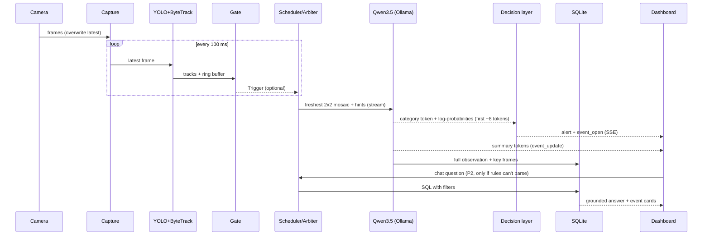

# SPEC.md: System Specification & Universal Contract

> **Version:** v1.4 (2026-10-15 23:20 IST): loitering/abandoned objects medium + optional watch zones (D35). v1.3 (23:00): demo machine M5; approved 9-item arbiter/metrics package (D31–D32). v1.2 (22:20): confidence from token log-probabilities + probability-based event rules (§6.5); P0 results applied (model, tile size, 1 slot). v1.1 added §5a dataflow and §12a edge cases · **Status:** 🟡 awaiting team sign-off (§15)
> **This is the single source of truth** for what we build and how the parts talk to each other. Decisions and their reasons live in [DECISIONS.md](DECISIONS.md); the schedule lives in [PLAN.md](PLAN.md).
> **Change rule:** anything in §6–§11 changes only with the captain's approval, a version bump here and a log entry in DECISIONS.md.

---

## 1. Purpose

Honeywell Problem Statement 3: a **fully local** system that ingests live or simulated video, detects and tracks objects, uses an open-source vision-language model (VLM) to **summarise** what's happening, **classifies** incidents into predefined categories with confidence, **stores** each event (timestamp, camera, category, summary, key frame), and lets users **query** the stored events in natural language through a chatbot.

**Constraints (hard):** open-source/open-weight models only, downloaded and run on the machine · no cloud APIs, no API keys · runs on a consumer laptop (**demo machine: the team's Apple M5 MacBook, 16 GB**; development and P0 benchmarks on a MacBook Air M4, 16 GB, and every number in the deck is re-measured on the M5) · must work offline.

## 2. Evaluation criteria → how we meet them

| Criterion | Our answer | Requirements |
|---|---|---|
| Summarisation | Per-window summaries, per-event summaries, live "now" line per camera, digests | FR-9, FR-16, FR-17 |
| Incident classification | 8 categories + normal, multi-frame VLM + detector hints + event merging | FR-7–FR-12 |
| Chatbot interface | Filters → SQL → grounded answer citing real event IDs with thumbnails | FR-18, FR-19 |
| Approach & workflow demo | Live Workflow view: every stage with its timing | FR-15 |
| **Latency (major)** | Gating, small mosaics, streaming early alert, prompt caching | FR-8, FR-9, NFR-1 |
| **Accuracy (major)** | Mosaic + hints + cross-check + merging + uncertainty re-look, measured on a held-out test set | FR-9–FR-12, FR-20, NFR-2 |
| Implementation | Clean modules, one-command launch, honest benchmark report | FR-21, FR-22 |

## 3. Functional requirements

**Priority:** **R1** = needed for the Round-1 evaluation (Fri 16 Oct 09:00, ready by 07:00) · **F** = needed for the final (Sat 17 Oct 08:00) · **S** = stretch.

| ID | Requirement | Pri |
|---|---|---|
| FR-1 | Ingest **video files** played at real-time speed, looped | R1 |
| FR-2 | Ingest the **webcam** (incl. iPhone via Continuity Camera, which appears as a webcam) | R1 |
| FR-3 | Ingest an **HTTP/RTSP stream URL** (Pixel "IP Webcam", RTSP cameras); auto-reconnect. **Built last in R1, dropped first at the 02:00 go/no-go; optional in the demo** (venue networking) | R1 (last) |
| FR-4 | Re-stream video files as RTSP via MediaMTX (simulated IP cameras) | F |
| FR-5 | **Upload a video in the UI → it becomes a new camera** (approved, D26). Drag-and-drop or file picker; mp4/mov/avi/mkv, ≤ 500 MB; plays once at real-time speed; removable. **Built last in R1, dropped first at the 02:00 go/no-go** (D32) | R1 (last) |
| FR-6 | YOLO + ByteTrack per camera (~10 FPS); annotated live stream (boxes, track IDs, door zone) | R1 |
| FR-7 | Gate rules: `person_down`, `fighting`, `crowd`, `tailgating`, `loitering`, `scene_change` (motion burst with no person) | R1: person_down, crowd, scene_change · F: all |
| FR-8 | VLM scheduler: baseline call every 3 s per camera (10 s if empty) + immediate high-priority call on a gate trigger; ≤ 1 pending request per camera; drop requests older than 2 s | R1 |
| FR-8a | **One model arbiter for ALL model calls (vision + chat)**, strict priority: ① gate-triggered incident calls (round-robin across cameras) → ② chat → ③ baseline checks → ④ re-looks. Baselines are skipped while any ① is pending. **Preemption:** a ① arriving while ③/④ runs **cancels** that call (closes the stream; Ollama stops it) and starts at once; a running ② chat call is cancelled and auto-retried right after. A running ① is never cancelled, but if another ① is waiting, the running one **stops its summary after ~15 words** and the rest is completed later at ④. A ③ baseline whose category is `normal` with c ≥ 0.80 stops after a ~12-word summary. 1 Ollama slot (D30) | R1 |
| FR-8b | Chat avoids the model where possible: a rule-based parser handles camera/category/time first; the model is called only if the rules can't parse the question, or for "summarise" answers. Count/list/latest answers are templates (no model call) | R1 |
| FR-8c | Each chat answer is a snapshot stamped "as of HH:MM:SS"; incidents that open while the user is chatting appear in the feed live, and the chat shows a "N new incidents since your question" chip | F |
| FR-9 | VLM call: 2×2 mosaic of 4 frames over ~2 s + detector hints → **streamed** JSON (§7.3) with token log-probabilities; **the category and its confidence are known from the first category token**, so the alert decision happens there | R1 |
| FR-9a | **Confidence score from log-probabilities** (§6.5): a probability for every category on every observation, calibrated on the dev set, shown in the UI as a % and a High/Medium/Low rating. The model never writes its own confidence | R1 (raw) · F (calibrated) |
| FR-10 | Cross-check the VLM label against detector evidence (e.g. "fighting" needs ≥ 2 people) | F |
| FR-11 | Event manager: merge windows into events with open/update/close (hysteresis, §6.4) | R1 |
| FR-12 | Uncertainty re-look: top probability in 0.4–0.7 **or** top-1 minus top-2 < 0.2 → same model re-checks with more frames, only when the queue is idle | F |
| FR-13 | SQLite store (observations + events + FTS5 search) + key frames on disk | R1 |
| FR-14 | Dashboard: camera grid, incident feed (thumbnail, badge, confidence % + High/Medium/Low rating, summary, ack), sound alert + toast for critical, metrics strip | R1 |
| FR-15 | **Workflow view**: live pipeline diagram with per-stage ms, the current mosaic, hints and raw VLM JSON | R1 |
| FR-16 | Live "what's happening now" summary line per camera | R1 |
| FR-17 | Digest: "summarise the last N minutes on camX" | F |
| FR-18 | Chat: filters by camera/category/time; list/count/latest/summary intents; grounded answers with clickable event cards | R1 (basic) · F (full) |
| FR-19 | Chat follow-ups ("what about cam1?") + "look again" (VLM re-reads a stored key frame) | F |
| FR-20 | Report tab: accuracy table, confusion matrix, latency table, **gate yield + gate ablation** (time-to-alert with gates vs baseline-only), **field-order ablation** (category first vs last), calibration chart, memory chart | F (preliminary numbers for R1 if ready) |
| FR-21 | Benchmark harness (accuracy, latency, ablation, chat test) | F |
| FR-22 | One-command launcher (`./run_demo.sh`): models → warm-up → app → browser | R1 |
| FR-23 | Seeded history (real pipeline output on real clips, timestamps shifted, `seeded=1`) so the chat has data | R1 |
| FR-24 | Voice question (local Whisper), face blur, PDF export, timeline, YOLO-pose, embeddings | S |

## 4. Non-functional requirements

| ID | Requirement | Target |
|---|---|---|
| NFR-1 | **Latency** | YOLO ≤ 40 ms/frame · VLM call p50 ≤ 1.5 s, p95 ≤ 2.5 s · **time-to-alert p95 ≤ 2.0 s** (one camera, empty queue; P0 measured 1.74/2.00 s in the model alone) · time-to-full-summary p95 ≤ 4 s · keep-up 100 % |
| NFR-2 | **Accuracy** | Macro F1 ≥ 0.75 on the held-out test set · summary quality ≥ 4.0/5 with 0 hallucinated people/objects · calibration error (ECE) ≤ 0.10 (reported-only if the fallback in E-1a is active) · chat filters ≥ 90 %, answers 100 % grounded |
| NFR-1a | **Contention** | With 2 simultaneous incidents + 1 chat question: 1st camera ≤ 2.5 s, **2nd camera ≤ 4.5 s** p95, reported as measured (calls run one at a time on this GPU, P0/D30; the running call's summary is cut short when another incident waits); chat answer ≤ 5 s. Measured by a stress test |
| NFR-3 | **Gates earn their keep** | **Gate ablation:** time-to-alert p95 with gates on is clearly lower than baseline-only (target ≥ 40 % lower; without gates an incident waits for the next 3 s tick) · **Gate yield** (% of model calls that were gate-triggered) reported. *(Replaces "calls saved vs every frame", which the 3 s timer alone satisfies, D31)* |
| NFR-4 | Resources | Peak memory ≤ 75 % of RAM; no swap thrash; 3–4 cameras on the M4 |
| NFR-5 | Stability | 30-min soak test, 3 cameras: no crash, no latency drift |
| NFR-6 | Local & open | Every model open-weight and local; works with Wi-Fi off; no CDN in the frontend |
| NFR-7 | Honesty | Every number in the deck comes from a committed benchmark run |

## 5. Architecture

```
Sources (file loop / webcam / iPhone-Continuity / IP-Webcam URL / RTSP)
  └─ Capture thread per camera ── keeps ONLY the latest frame
       └─ Detector thread per camera: YOLO + ByteTrack (own model instance per camera) → ring buffer (last 4 s)
            ├─ Gate rules ──trigger──┐
            └─ Baseline timer ───────┴─► Scheduler (priority queue, drop stale)
                                           └─ VLM worker: mosaic + hints → local VLM server (streaming JSON)
                                                ├─ category parsed → EARLY ALERT (SSE)
                                                └─ full JSON → cross-check → Event manager
                                                     └─ SQLite + FTS5 + key frames ─► FastAPI ─► SSE ─► React dashboard
Chat: question → VLM-as-LLM extracts filters (JSON) + rule-based extractor → Python time parsing → SQL → template / grounded LLM answer
```

| Component | Technology |
|---|---|
| Language/runtime | Python 3.12 (via uv) |
| Detection/tracking | Ultralytics **YOLO26-nano on CPU** + ByteTrack (D34). CPU keeps the GPU free for the VLM; GPU YOLO is also not thread-safe (Metal abort) and needs a lock |
| VLM | **Qwen3.5-4B** (fallback **Qwen3.5-2B**, same prompt) via Ollama; GGUF vs MLX build picked by a 10-min latency test (D22) |
| VLM server | **Ollama** (OpenAI-compatible, streaming, JSON-schema output) |
| Chat LLM | The same VLM (D8/Q12) |
| Backend | FastAPI + uvicorn, one process; pipeline in background threads |
| Model adapter | `app/models.py`: one thin client for any OpenAI-compatible local server (Ollama now; mlx-vlm/llama.cpp later). Swapping model or backend = a config change |
| Storage | SQLite (WAL) + FTS5; JPEGs on disk. **Not** Pinecone/Supabase (cloud, API keys → breaks the on-prem rule) or Milvus (needs a multi-container server, built for millions of vectors; our queries are structured filters over thousands of rows). If semantic search is added (S), embeddings live in the same SQLite file (`sqlite-vec`) |
| Frontend | React + Vite + Tailwind, built locally, served by FastAPI |
| RTSP sim | MediaMTX + ffmpeg |

## 5a. Dataflow, step by step (the exact behaviour; the code must match this)

### 5a.1 Life of a frame → alert
| # | Step | Where | What exactly happens | Time budget |
|---|---|---|---|---|
| 1 | **Capture** | `ingest.py`, 1 thread/camera | Reads frames at the source's rate (webcam 30 FPS; files played at their native FPS against the wall clock). **Overwrites a single "latest frame" slot**, stamped `t_capture = time.time()`. No queue | — |
| 2 | **Detect** | `detect.py`, 1 thread/camera | Every 100 ms (10 FPS) takes the latest slot *if it's newer than the last one processed* (otherwise waits). YOLO + ByteTrack (own model instance per camera). Appends `(t_capture, frame resized to 640 px wide, tracks)` to the camera's **ring buffer (last 4 s ≈ 40 entries)**, updates per-track features (aspect ratio, speed in box heights/s, dwell, door-zone entries); all durations from `t_capture` differences, never frame counts, encodes the annotated JPEG for the live view | ≤ 40 ms |
| 3 | **Gate** | `gate.py`, same thread | Runs every rule on the buffer (~1 ms) → zero or more Triggers (§7.4); rules in §6.6. `scene_change` = mean absolute difference between the current and the 0.5 s-old frame (both 160 px grey), **ignoring person boxes**, above `scene_change_frac` | ~1 ms |
| 4 | **Schedule** | `scheduler.py` | A Trigger becomes a **P1 request** unless (a) that camera already has a P1 queued, or (b) an event of the trigger's category is open on that camera (cooldown), or (c) < 1 s since this camera's last P1 call. Otherwise, if ≥ `baseline_interval_s` since this camera's last call **and no P1 is waiting anywhere**, a **P3 baseline request** is made. A **P3** request holds only `{camera_id, created_at}`. A **P1** request **freezes its 4 mosaic frames at trigger time** (the incident moment, ~100 KB) plus the hints; up to **3 waiting P1s per camera** (oldest dropped only beyond that) | — |
| 5 | **Dispatch** | arbiter (`models.py`) | When a model slot frees: take the highest priority (P1 → P2 chat → P3 → P4 re-look), round-robin across cameras within P1. **P3/P4:** the mosaic is built now from the freshest 4 buffer frames at offsets −2.0, −1.33, −0.67, 0 s (nearest available; fewer tiles if the buffer is shorter). **P1:** uses its frozen trigger-time frames, so a delayed P1 still analyses the incident moment. **P1s are never downgraded**; one that waited > 4 s is flagged `delayed` | queue wait 0–1.5 s under contention |
| 6 | **VLM call** | `vlm.py` | **Ollama native `POST /api/chat`** (verified to return `logprobs`/`top_logprobs` *with* JSON-schema decoding active; the alternatives are already restricted to legal tokens) with `stream: true`, `format` = JSON schema (§7.3), `temperature 0`, `num_predict 80`, `think: false`, `keep_alive: -1`. **Prompt order fixed for prefix caching:** identical system prompt (all static text, incl. the task instruction) → image → hints (per-frame, dynamic); `num_ctx: 4096` on every vision and chat call (D38); `prompt_eval_cached_count` is logged per call and shown in the Workflow view. Tokens are parsed incrementally | measured in the latency test |
| 7 | **Early decision** | `events.py` | As soon as the **first token of the category value** arrives (`t_category`, ~8 tokens): its log-probabilities give the probability of every category (§6.5) → cross-check (§12a E-7) → event-manager rules (§6.4). **If an event opens → SSE `alert` + `event_open` immediately**, with the summary shown as "…" | **time-to-alert target ≤ 2.0 s p95** |
| 8 | **Summary stream** | `events.py` → SSE | Summary tokens are pushed as `event_update` at most every 200 ms, so the card text types itself live | — |
| 9 | **Persist** | `db.py` | At `t_vlm_done`: write the Observation (always, including `normal`); attach it to the event if one opened or updated; save a 320 px thumbnail; if it's the event's new peak, save the full-resolution newest frame + the mosaic as key frames. SSE `observation` (updates the camera's "now" line) + `trace` (Workflow view) | ≤ 20 ms |
| 10 | **Close** | `events.py`, 1 s timer | Any open event with no supporting observation for `close_after_s` (8 s) → `closed`, SSE `event_close` | — |

### 5a.2 Life of a chat question
| # | Step | What exactly happens |
|---|---|---|
| 1 | Request | `POST /api/chat {session_id, question}`; `as_of = now` |
| 2 | **Rule parser** (< 5 ms, no model) | Regex/synonyms: camera ids or names ("camera 2", "cam2", "lobby"), categories + synonyms ("fall" → person_down), intent words ("how many" → count, "last"/"latest" → latest, "summarise" → summary), time phrases. **If the intent is known and at least one filter (or "all") was found → skip the model** |
| 3 | Model extraction (only if step 2 can't parse) | Arbiter priority **P2**, text-only, JSON-schema output, `max_tokens 80`, timeout 8 s → on timeout, fall back to the step-2 result and say so in the answer |
| 4 | Time resolution | Python, IST: "today" = 00:00 IST → now; "yesterday"; "last N min/hours"; "this morning" 06–12, "afternoon" 12–17, "evening" 17–22; "at 3 pm" = 14:45–15:15; "since 3 pm"; "between X and Y". No time phrase → **all time** |
| 5 | Retrieval | `query_events` / `count_events` (non-dismissed events only). `summary` intent, or 0 events matched → also `query_observations` |
| 6 | Answer | `list`/`count`/`latest`/`detail` → **template, no model**. `summary` → model at P2 with the rows (max 30) and `max_tokens 150`; any cited `[#id]` not in the rows is stripped. 0 rows → "No matching events between … and … (filters: …)" |
| 7 | Response | `{answer, events, filters, as_of, latency_ms}`. The UI shows "as of HH:MM:SS"; if new events open later, a "N new incidents since this answer" chip appears (FR-8c) |

### 5a.3 Sequence diagram


## 6. Categories, severity, rules

### 6.1 Categories

| `category` | Definition (used verbatim in the VLM prompt) | `subtype` values | Severity |
|---|---|---|---|
| `fire_smoke` | Visible flames or smoke | `fire`, `smoke` | critical |
| `fighting` | 2+ people in physical aggression: punching, kicking, shoving, wrestling | null | critical |
| `person_down` | A person lying or collapsed on the floor (fall, fainting), not sitting or resting on furniture | null | critical |
| `crowd_incident` | Abnormally dense gathering, or a crowd suddenly running/dispersing | `gathering`, `running` | high |
| `property_damage` | Damage to property or a hazardous object event, accidental or deliberate: an object/debris falling, a structure collapsing, items knocked over and broken, shattered glass, vandalism | `falling_object`, `collapse`, `breakage`, `vandalism` | high |
| `suspicious_activity` | Loitering, trespassing/climbing, theft/shoplifting, an abandoned object, a visible weapon | `weapon`, `theft`, `trespass`, `loitering`, `abandoned_object`, `other` | **by subtype** (D35): `weapon`, `theft`, `trespass`, `other` → critical · `loitering`, `abandoned_object` → medium |
| `tailgating` | A second person follows closely through a door/gate on one opening | null | medium |
| `normal` | None of the above | null | none |

### 6.2 Tie-break (most severe wins when several apply)
`fire_smoke > fighting > person_down > crowd_incident > property_damage > suspicious_activity > tailgating > normal`

### 6.3 Alerts
Critical and high → sound + toast + red pulsing camera border. Medium → feed card only.

### 6.4 Event lifecycle
- **Alert = open.** The sound/toast fires exactly when an event opens, never for a single observation that doesn't open one. So critical categories alert on the first confident observation (~1 window), others on the second agreeing one (~3 s later): the speed vs false-alarm trade-off, per severity.
- **Open, close and update follow the probability rules in §6.5.**
- **Update:** extend `end_ts`, union `track_ids`, `n_obs += 1`; a new peak confidence replaces the summary and key frames.
- **Closed events never reopen**; a new event starts instead.

### 6.5 Confidence score & probability-based rules
**Where the number comes from.** The model writes the category value token by token. At its **first token** we read the top-10 log-probabilities, map each candidate token to the category names it starts (e.g. `fight` → fighting, `s` → suspicious_activity), and renormalise over the 8 categories → `probs = {category: p}`, which sums to 1. Each category name must start with a distinct first token; this is checked at startup, and a colliding name is reworded in the prompt.

**Calibration.** `p_cal = softmax(log p / T)`, with the temperature `T` fitted on the dev set (default 1.0). We report the calibration error (ECE) and a reliability chart in the report.

**Evidence adjustment (cross-check, E-7).** `c = clamp(p_cal × f)`, where `f = 1.15` if a gate trigger supports the category, `0.5` if detector evidence contradicts it, `1.0` otherwise.

**Window score.** For each (camera, category): `S = mean of c over the last 3 observations` (every observation carries a probability for *every* category, so this needs no special cases).

| Rule | Condition (defaults in config, tuned on the dev set) |
|---|---|
| **Open, critical category** | One observation with `c ≥ 0.70` **and** corroborated (supporting gate trigger, or the category is `fire_smoke`), **or** `S ≥ 0.55` over ≥ 2 observations |
| **Open, high/medium category** | `S ≥ 0.55` over ≥ 2 observations, **or** one observation with `c ≥ 0.85` and corroborated |
| **Close** | No observation with `c ≥ 0.40` for that category for 8 s |
| **Re-look** (FR-12) | Top `c` in 0.40–0.70, or top-1 − top-2 < 0.20 |
| **Shown as** | `c` as a %, plus a rating: **High** ≥ 0.80 · **Medium** 0.60–0.80 · **Low** < 0.60 |

An event's `peak_confidence` is the highest `c` it reached. The full `probs` map is stored on every observation.
- **Cooldown:** per (camera, category) while an event is open, not per camera.

### 6.6 Gate rules (motion)
Shared conventions: **speed = centroid displacement over the last 0.3 s ÷ elapsed time ÷ box height** (body heights per second, so a person far from the camera scores the same as one close up); every duration is measured from `t_capture` differences, so the thresholds hold if the detector falls below 10 FPS; tracks younger than `min_track_age_s` are ignored (a ByteTrack ID switch makes a fresh ID whose first jump looks like a speed spike).

| Rule | Fires when (defaults in §10) | Trigger |
|---|---|---|
| `person_down`: fast drop | The top of a box moves down by ≥ `drop_frac` (0.4) × its height within `drop_window_s` (0.5 s). Fires *during* the fall instead of after it; sitting or bending can fire it too, which costs one VLM call | `gate:person_down` |
| `person_down`: horizontal | Box width ≥ `down_ratio` (1.2) × height on every frame for `down_hold_s` (0.5 s). Catches falls the drop rule misses (slow slump, person enters already down) | `gate:person_down` |
| `fighting` | Two tracked people whose boxes overlap, with either moving at ≥ `fight_speed` (1.0 body heights/s); normal walking is ≈ 0.8 | `gate:fighting` |

Both `person_down` variants emit the same rule name, so the scheduler's per-camera dedupe (§5a step 4) merges them. Thresholds are tuned on the staged and look-alike clips (sitting, bending, hugging). Implemented in `app/gate.py`.

## 7. Data contracts

**Conventions:** every time is **epoch seconds (float)**, displayed in **IST**. Camera IDs are `cam1…camN`. Category and subtype strings are exactly as in §6.1. JSON keys are snake_case.

### 7.1 Observation (one per VLM window, including `normal`)
```json
{
  "id": 1, "camera_id": "cam1", "ts": 1760524800.12,
  "category": "normal", "subtype": null, "confidence": 0.91,
  "probs": {"normal": 0.91, "suspicious_activity": 0.05, "fighting": 0.02, "person_down": 0.01, "crowd_incident": 0.01, "fire_smoke": 0.0, "property_damage": 0.0, "tailgating": 0.0},
  "summary": "Two people walking toward the exit.", "people_count": 2,
  "trigger": "baseline",
  "track_ids": [4, 7], "thumb_path": "data/thumbs/cam1/1760524800.jpg", "event_id": null,
  "model": "qwen3.5:4b",
  "timing": { "t_capture": 1760524799.20, "t_detect_done": 1760524799.23, "t_gate": 1760524799.24,
              "t_vlm_start": 1760524799.30, "t_first_token": 1760524799.85, "t_category": 1760524799.92,
              "t_vlm_done": 1760524800.60, "t_db_write": 1760524800.62 }
}
```
`trigger` ∈ `baseline` · `gate:person_down` · `gate:fighting` · `gate:crowd` · `gate:tailgating` · `gate:loitering` · `gate:scene_change` · `relook`

### 7.2 Event (a merged incident)
```json
{
  "id": 12, "camera_id": "cam2", "camera_name": "Lobby Door",
  "category": "tailgating", "subtype": null, "severity": "medium",
  "start_ts": 1760524810.0, "end_ts": 1760524816.5, "peak_confidence": 0.88,
  "summary": "A second person follows closely through the door behind the first.",
  "keyframe_paths": ["data/keyframes/12_0.jpg", "data/keyframes/12_mosaic.jpg"],
  "track_ids": [3, 5], "status": "open",
  "n_obs": 3, "time_to_alert_ms": 910, "latency_ms": 1420, "seeded": false
}
```
`status` ∈ `open` · `closed` · `acknowledged` · `dismissed` (a re-look downgraded it; kept for audit, hidden from the feed by default)

### 7.3 VLM output (strict JSON, **fields in this order**: `category` first, `summary` last)
```json
{ "category": "fighting", "subtype": null, "people_count": 3,
  "summary": "≤ 30 words, objective: who, what, where in frame" }
```
- **No `confidence` field**: confidence comes from log-probabilities (§6.5). This saves ~6 output tokens.
- `subtype` is constrained in the JSON schema to the allowed list for the chosen category (§6.1), or null.
- Invalid or unparseable output → observation `{"category": "normal", "confidence": 0}`, logged as a VLM error.

### 7.4 Trigger (gate → scheduler)
```json
{ "camera_id": "cam1", "rule": "person_down", "track_ids": [7], "score": 0.8,
  "hint": "Track 7 changed from upright to horizontal 1.2 s ago and is not moving." }
```

### 7.5 Chat
Request `POST /api/chat`
```json
{ "session_id": "abc", "question": "Show tailgating events from camera 2 today" }
```
Extracted filters (internal; shown in the UI for transparency)
```json
{ "intent": "list", "cameras": ["cam2"], "categories": ["tailgating"],
  "t_from": 1760466600, "t_to": 1760553000, "keywords": null, "event_id": null, "limit": 20 }
```
`intent` ∈ `list` · `count` · `latest` · `summary` · `detail` · `visual_question`

Response
```json
{ "answer": "3 tailgating events on Lobby Door (cam2) today: [#12] 10:14, [#15] 11:02, [#19] 13:40.",
  "events": [ /* Event objects */ ], "filters": { /* as above */ }, "latency_ms": 1200 }
```
**Grounding rules:** the answer may cite only event IDs present in `events`. Zero rows → "No matching events" + the filters used. Count/list/latest answers are templated (no LLM text).

## 8. Database schema (SQLite, WAL)
```sql
CREATE TABLE observations (
  id INTEGER PRIMARY KEY, camera_id TEXT NOT NULL, ts REAL NOT NULL,
  category TEXT NOT NULL, subtype TEXT, confidence REAL, probs TEXT, summary TEXT, people_count INTEGER,
  trigger TEXT, track_ids TEXT, thumb_path TEXT, event_id INTEGER, model TEXT, timing TEXT, seeded INTEGER DEFAULT 0);
CREATE INDEX idx_obs_cam_ts ON observations(camera_id, ts);

CREATE TABLE events (
  id INTEGER PRIMARY KEY, camera_id TEXT NOT NULL, category TEXT NOT NULL, subtype TEXT, severity TEXT,
  start_ts REAL NOT NULL, end_ts REAL, peak_confidence REAL, summary TEXT, keyframe_paths TEXT,
  track_ids TEXT, status TEXT DEFAULT 'open', n_obs INTEGER DEFAULT 1,
  time_to_alert_ms INTEGER, latency_ms INTEGER, seeded INTEGER DEFAULT 0);
CREATE INDEX idx_evt_cam_ts ON events(camera_id, start_ts);

CREATE VIRTUAL TABLE events_fts USING fts5(summary, category, content='events', content_rowid='id');
CREATE VIRTUAL TABLE observations_fts USING fts5(summary, content='observations', content_rowid='id');
```
JSON-valued columns (`track_ids`, `keyframe_paths`, `timing`, `probs`) are stored as JSON text.

## 9. HTTP API (FastAPI, `http://localhost:8000`)

| Method | Path | Returns |
|---|---|---|
| GET | `/api/cameras` | `[{id, name, source_type, status, fps, has_door_zone}]` |
| POST | `/api/cameras` | add a source `{name, source}` → camera *(F)* |
| POST | `/api/cameras/upload` | multipart video → new camera `{id, name, status}` (FR-5) |
| DELETE | `/api/cameras/{id}` | remove a camera (R1, needed for FR-5) |
| GET | `/stream/{camera_id}` | MJPEG live view with overlays |
| GET | `/api/events?camera=&category=&from=&to=&status=&q=&limit=` | `[Event]` |
| GET | `/api/events/{id}` | `Event` + its observations |
| POST | `/api/events/{id}/ack` | `Event` |
| GET | `/api/observations?camera=&from=&to=&q=&limit=` | `[Observation]` |
| GET | `/api/metrics` | §9.1 |
| GET | `/sse` | server-sent events, §9.2 |
| POST | `/api/chat` | §7.5 |
| GET | `/api/report` | benchmark results JSON (`bench/report.json`) |
| GET | `/media/keyframes/*`, `/media/thumbs/*`, `/media/mosaics/*` | images |
| GET | `/` | the built React app |

### 9.1 Metrics payload
```json
{ "cameras": { "cam1": { "capture_fps": 30, "det_fps": 10, "yolo_ms_p50": 18, "keep_up": 1.0, "status": "live" } },
  "vlm": { "model": "qwen3.5:4b", "p50_ms": 1100, "p95_ms": 1900, "alert_p95_ms": 950, "queue_depth": 0,
           "calls_total": 412, "gate_yield_pct": 31.0, "cache_hit_tokens": 212, "preemptions": 4, "errors": 0 },
  "system": { "mem_used_pct": 61, "uptime_s": 3600 } }
```

### 9.2 SSE message types
| `type` | `data` |
|---|---|
| `event_open` / `event_update` / `event_close` | Event |
| `alert` | `{event_id, camera_id, category, severity, confidence, rating}`, sent the moment the first category token arrives and the open rule passes |
| `observation` | Observation (drives the live "now" line) |
| `trace` | `{camera_id, trigger, stages: [{name, ms}], mosaic_url, hints, raw_json}` (drives the Workflow view) |
| `metrics` | §9.1, every 1 s |
| `camera_status` | `{camera_id, status: live|reconnecting|down}` |

## 10. Configuration (`config.yaml`)
```yaml
cameras:
  - { id: cam1, name: "Front Desk (webcam)", source: 0 }
  - { id: cam2, name: "Lobby Door (iPhone)", source: 1, door_zone: [[0.42,0.20],[0.58,0.20],[0.58,0.95],[0.42,0.95]] }
  - { id: cam3, name: "Corridor (Pixel)", source: "http://192.168.43.20:8080/video" }
  - { id: cam4, name: "Warehouse (recorded)", source: "data/demo/warehouse.mp4" }
detector: { model: models/yolo26n.pt, fps: 10, imgsz: 480, conf: 0.35, device: cpu }
vlm:  { base_url: "http://localhost:11434", endpoint: "/api/chat", model: "qwen3.5:4b-mlx", confidence_source: logprobs   # or "model_field" (fallback), stream: true, temperature: 0, logprobs: true, top_logprobs: 10,
        max_tokens: 80, mosaic_frames: 4, mosaic_span_s: 2.0, tile_px: 224,
        baseline_interval_s: 3, empty_interval_s: 10, trigger_max_age_s: 4, timeout_s: 6, relook: { c_low: 0.40, c_high: 0.70, margin: 0.20 },
        think: false, keep_alive: -1, num_ctx: 4096, parallel_slots: 1 }   # 2 slots measured: no gain on this GPU (D30)
replay: { store_events_on_replay: true, reset_live_tables_on_start: true }
gate: { crowd_min: 8, crowd_rise: 5, tailgate_window_s: 2.5, loiter_s: 30, down_ratio: 1.2, down_hold_s: 0.5,
        drop_frac: 0.4, drop_window_s: 0.5, fight_speed: 1.0, min_track_age_s: 0.5, scene_change_frac: 0.25 }
events: { open_single_critical: 0.70, open_single_other: 0.85, open_window: 0.55, window_n: 3, close_c: 0.40, close_after_s: 8,
          corroborate_boost: 1.15, contradict_factor: 0.5, calibration_T: 1.0,
          rating: { high: 0.80, medium: 0.60 } }
chat: { base_url: "same-as-vlm", model: "same-as-vlm" }
```

## 11. Repository layout & ownership

| Path | Contents (all built by Claude) | Validated by |
|---|---|---|
| `app/ingest.py` | capture threads | Abhinav |
| `app/detect.py` | YOLO + ByteTrack, ring buffer, track features | Abhinav |
| `app/gate.py` | gate rules + hints | Abhinav |
| `app/scheduler.py` | VLM queue | Shivansh |
| `app/vlm.py` | mosaic, prompt, streaming client, cross-check, re-look | Shivansh |
| `app/events.py` | event manager | Shivansh |
| `app/db.py` | SQLite + FTS | Riddhi |
| `app/chat.py` | filter extraction, time parsing, retrieval, answers | Riddhi |
| `app/server.py`, `app/pipeline.py`, `app/config.py` | API, SSE, wiring | Aryan |
| `web/` | React dashboard | Aryan |
| `bench/` | labels, harness, report | Riddhi (data) · Shivansh (model numbers) |
| `scripts/` | launcher, RTSP sim, seeding, data prep | Shivansh |
| `data/` | videos, key frames, DB (**gitignored**; `data/README.md` has sources) | Riddhi |

Every module has a runnable self-check: `uv run python -m app.<module>`.

## 12. Measurement definitions
- **YOLO latency** = `t_detect_done − t_capture`
- **VLM latency** = `t_vlm_done − t_vlm_start`
- **Time-to-alert** = `t_category − t_capture` (newest frame in the mosaic → category known → alert sent)
- **Time-to-full-summary** = `t_vlm_done − t_capture`
- **End-to-end** = `t_db_write − t_capture`
- **Keep-up** = frames processed by YOLO ÷ frames sampled for YOLO
- **Gate yield** = gate-triggered model calls ÷ all model calls
- **Gate ablation** = time-to-alert p95, gates on vs `scheduler.mode: periodic` (baseline only), same clips
- **Field-order ablation** = time-to-alert and macro F1 with `category` first vs last in §7.3
- **Clip prediction** (accuracy runs) = highest-`peak_confidence` non-`normal` event in the clip, else `normal`
- **Calibration error (ECE)** = mean |accuracy − confidence| over 10 confidence bins, weighted by bin size, on the test set
- **Macro F1** over all 9 labels (8 categories + normal), on the **held-out test set**, never used for tuning
- Latency stats: p50 / p95 / max over ≥ 50 events, first 5 discarded as warm-up

## 12a. Runtime behaviour & edge cases (resolved, no ambiguity left)

Each line is a decision. ✋ = decided by Claude; the team can veto.

**Model & contention**
- **E-1** One model serves vision and chat through one arbiter with priorities P1 incident → P2 chat → P3 baseline → P4 re-look (FR-8a). Preemption rules as in FR-8a. ✋
- **E-1a** **Confidence fallback:** if log-probabilities are ever unavailable, `confidence_source: model_field` restores a `confidence` field in §7.3 (~6 extra tokens); §6.5's rules are unchanged (they only consume `c`); ECE becomes "reported, not targeted". ✋
- **E-2** **1 Ollama slot.** 2 slots were tested (P0) and calls still ran one at a time on the M4 GPU, so the arbiter's priority order is what protects incident latency. ✋
- **E-3** Model stays loaded (`keep_alive: -1`) and gets a warm-up call at startup; a cold load (~5–10 s) must never happen during the demo. ✋
- **E-4** Qwen3.5 "thinking" mode is **off** for every call (it would add seconds). ✋
- **E-5** A VLM call that errors or exceeds 6 s → logged as `vlm_error`, no observation is stored, and the camera simply gets its next window. Three errors in a row → the VLM status dot turns red; detection and the live view keep running. ✋

**Classification & events**
- **E-6** At most **one open event per (camera, category)**. Different categories can be open on the same camera at once (a fight and a person down are two events). ✋
- **E-7** Cross-check runs at `t_category`, *before* the alert: `fighting` needs ≥ 2 persons in the last 2 s of tracks; `crowd_incident` needs ≥ 0.6 × `crowd_min` persons; `person_down` needs ≥ 1 person; `tailgating` needs a door zone and ≥ 2 entries; `fire_smoke` and `property_damage` need no detector evidence. Contradicting evidence multiplies the category's probability by 0.5; a supporting gate trigger multiplies it by 1.15 (§6.5). ✋
- **E-8** If the label flips during an event (fight → normal → fight within 8 s), it stays one event. Only 8 s without support closes it. ✋
- **E-9** A re-look (P4) that disagrees with an open event marks it `dismissed` and sends an `event_close`; the UI shows "dismissed after re-check" for 5 s, then hides it. It's the only way an alert is retracted. ✋
- **E-10** Severity of `suspicious_activity` follows its subtype (D35): `weapon`, `theft`, `trespass`, `other` = critical (sound); `loitering`, `abandoned_object` = **medium (card only, no sound)**. **Loitering zones:** if a camera has a `watch_zone`, loitering counts only for people standing inside it (live demo cameras, set at venue setup); with no zone (dataset clips, uploads) the whole frame counts. Note: dataset clips are 10–30 s, shorter than `loiter_s`, so there loitering is detected by the model's baseline checks, not the dwell trigger. Team
- **E-11** Observation `ts` = `t_capture` of the newest frame in its mosaic.

**Sources**
- **E-12** Webcam/Continuity indices can change between reboots: `scripts/list_cameras.py` prints index → name → resolution, and the venue setup step sets the indices in `config.yaml`. ✋
- **E-13** A camera that disconnects → `reconnecting` (backoff 1/2/4 s, max 5 s), its tile shows "reconnecting", its open events close normally after 8 s. ✋
- **E-14** **Looping video files:** every loop is processed like live footage and its events are stored (it *is* the system working). `./run_demo.sh` resets the live tables at start, so counts reflect the current session; seeded history (`seeded=1`) is re-inserted. Config `store_events_on_replay: false` turns storing off for a camera. ✋
- **E-15** Phone IP-camera URLs change with the hotspot IP: set at the venue in `config.yaml`, tested by `scripts/list_cameras.py --url <url>`. ✋
- **E-16** Door zones are set per camera in `config.yaml` (normalised polygon). A UI editor is a stretch goal. ✋
- **E-17** Uploaded videos (FR-5) become `camN` with the next free number, play once (no loop), and are removable. ✋

**Storage & UI**
- **E-18** Everything (DB, key frames, thumbnails) stays in `data/`, never committed, never leaves the machine. ✋
- **E-19** Seeded history is included in chat answers and marked with a "history" tag on its cards; live events are never mixed up with it. ✋
- **E-20** The sound plays once per event open (not repeated). **Acknowledge** = stop the red border, set `acknowledged`; the event still closes normally. ✋
- **E-21** The Workflow view shows the latest trace for the selected camera (default: whichever camera fired last). ✋
- **E-22** All summaries and answers are in English. Times are shown in IST, 24-hour clock. ✋
- **E-23** The benchmark uses **the same pipeline code** with a virtual clock (accuracy mode) or the real clock (latency mode). No separate "benchmark-only" logic. ✋

## 13. Acceptance criteria

**Round 1 (Fri 07:00):**
- [ ] `./run_demo.sh` starts everything from cold in < 2 min
- [ ] 3 cameras live (webcam + 1 phone or recorded + 1 recorded), boxes visible, keep-up 100 %
- [ ] A staged fall on the webcam → critical alert on screen; time-to-alert shown
- [ ] Recorded fight / fire / crowd clips → correct incident cards with summaries
- [ ] Workflow view shows stage timings and the mosaic in real time
- [ ] Chat answers "what incidents happened in the last 10 minutes?", "how many falls today?", "show fights on cam4" correctly, citing real events
- [ ] Metrics strip shows live YOLO ms, VLM p50/p95, time-to-alert

**Final (Sat 08:00):** all R1 + F requirements, NFR targets measured and reported, 30-min soak test passed, 3 rehearsals done.

## 14. Out of scope
Face recognition, identity tracking across cameras, cloud deployment, training models from scratch, mobile app.

## 15. Sign-off

| Name | Role | Agreed (✅ / comments) |
|---|---|---|
| Shivansh | Captain · AI/Model | |
| Abhinav | Vision & Cameras | |
| Riddhi | Data & Chat | |
| Aryan | Product & Pitch | |

## 16. Pending decisions (do not block the build)
1. ~~`suspicious_activity` severity~~: resolved by subtype; loitering and abandoned objects are medium (E-10, D35).
2. ~~FR-5 video upload~~: resolved, yes, in Round 1 (D26).
3. GGUF vs MLX build of Qwen3.5-4B, and whether we must drop to the 2B: decided by a 10-min latency test after download.
